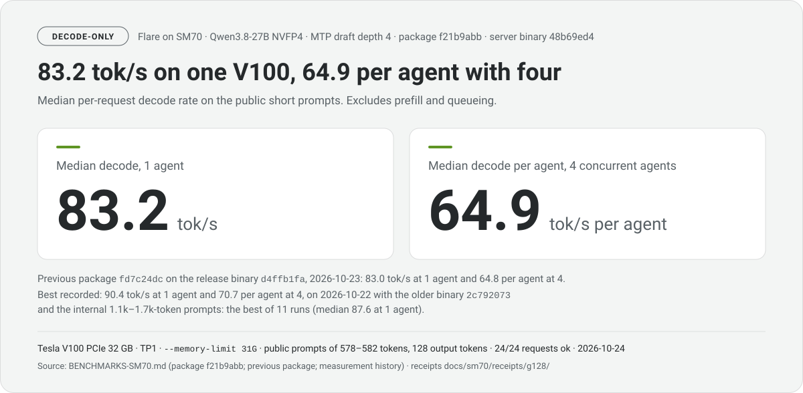
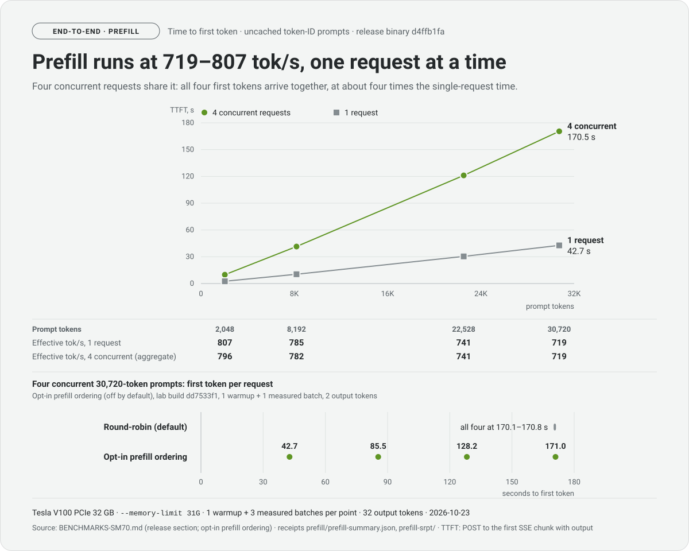
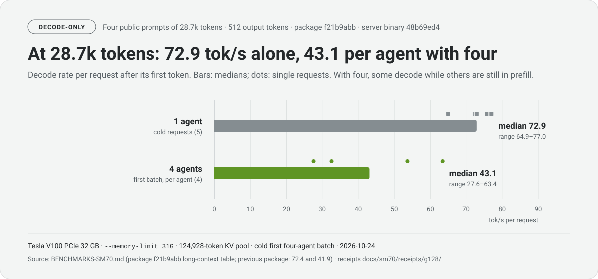
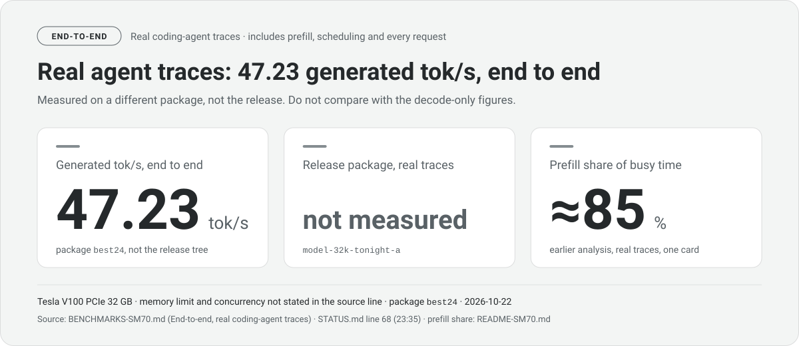
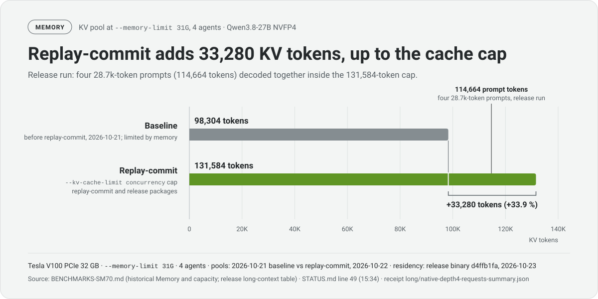
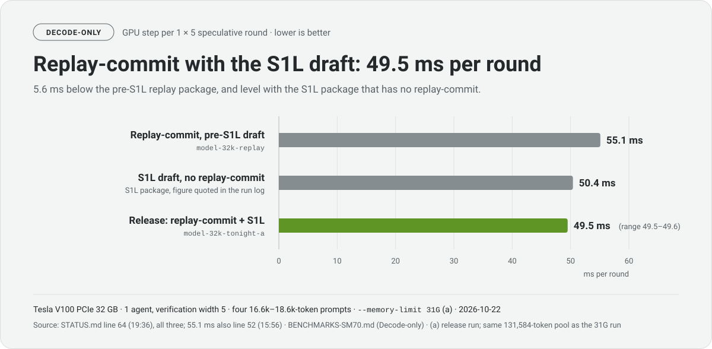

# Flare on SM70 (Tesla V100 PCIe 32 GB)

<picture>
  <source media="(prefers-color-scheme: dark)" srcset="docs/sm70/img/hero-dark.svg">
  <source media="(prefers-color-scheme: light)" srcset="docs/sm70/img/hero-light.svg">
  
</picture>

This fork adds an SM70 (Volta) execution path to
[flare-local-inference](https://github.com/NVIDIA/flare-local-inference).
Upstream Flare targets SM120/SM121 GPUs. This branch serves one recipe on one
Tesla V100 32 GB:

- `qwen3.8-27b` (`nvidia/Qwen3.8-27B-NVFP4`, revision `482ca0f`), TP1;
- the checkpoint's MTP head for speculative decoding, draft depth up to 4;
- up to 4 concurrent requests and up to 32,768 tokens per request.

The port is maintained in this fork. It is not supported upstream.

**Who it is for.** Use it if you have V100 32 GB cards and want to serve
Qwen3.8 27B for coding agents or other local clients through an
OpenAI-compatible API. It also documents how to keep speculative decoding
bit-exact on a GPU without BF16 tensor cores. For any other model, GPU, more
than 4 concurrent requests or contexts above 32,768 tokens, use upstream Flare.

**This release.** The current public checkout has passed export
qualification, an independent rebuild and an SM70/SM120 comparison
([validation record](docs/sm70/ARCHITECTURE.md#public-release-review-and-current-validation)),
and its release binary `d4ffb1fa` was benchmarked on 2026-10-23 (below). The
earlier 2026-10-22 results of release tree `0e4c81f` and its packages are kept,
labelled historical. On top of the SM70 base port, the release carries four
changes, explained in [ARCHITECTURE.md](docs/sm70/ARCHITECTURE.md):

- the scheduler hang fix (`e81534a`, `718a187`);
- prefill projections on the pgemm kernel (`8ad725c`);
- the S1L decode, verification and draft attention (`0aea71a`, `ca16f00`);
- GDN replay-commit (`d3258bc` to `7cb1bc7`), with credit to
  [Strata](https://github.com/Niko1221/Strata/blob/main/include/strata/kernels/verify_kernels.hpp)
  for the accepted-token GDN state replay idea. This fork stores verification
  operands and integrates one committed row per request with Flare's graph,
  state contract and shared KV pool.

## Measured results

All rows: Qwen3.8-27B NVFP4 on one Tesla V100 PCIe 32 GB, TP1, release binary
`d4ffb1fa`, release export package (primary SHA-256 prefix `fd7c24dc`),
`--memory-limit 31G`, 8G prefix cache, `--max-concurrency 4`,
`--mtp-draft-tokens 4` with fixed-width verification, measured on 2026-10-23 on
newly authored public prompts. The full tables, the receipts and the
[measurement history](BENCHMARKS-SM70.md#measurement-history-2026-10-20-to-2026-10-23) are in
[BENCHMARKS-SM70.md](BENCHMARKS-SM70.md#release-binary-d4ffb1fa-built-from-71029458-production-source-unchanged-through-c6fdc120).

Prefill, decode-only and end-to-end figures measure different things. Do not
compare a number from one table with a number from another.

### Prefill and time to first token

Uncached token-ID prompts, 32 output tokens, 1 warmup and 3 measured batches per
row. TTFT runs from the request to the first streamed output and includes
queueing and transport. The rate is effective prefill over the first-token wall
window, not pure GPU time.

| Prompt tokens | TTFT p50, 1 request | Effective prefill, 1 request | TTFT p50, 4 concurrent requests | Effective prefill, 4 concurrent (aggregate) |
| ---: | ---: | ---: | ---: | ---: |
| 2,048 | 2.54 s | 807 tok/s | 9.89 s | 796 tok/s |
| 8,192 | 10.43 s | 785 tok/s | 41.44 s | 782 tok/s |
| 22,528 | 30.39 s | 741 tok/s | 121.11 s | 741 tok/s |
| 30,720 | 42.75 s | 719 tok/s | 170.49 s | 719 tok/s |

Concurrent prefills do not overlap. Four requests prefill no faster in total
than one, and the server interleaves them, so all four first tokens arrive
together at about four times the single-request TTFT.

<picture>
  <source media="(prefers-color-scheme: dark)" srcset="docs/sm70/img/prefill-dark.svg">
  <source media="(prefers-color-scheme: light)" srcset="docs/sm70/img/prefill-light.svg">
  
</picture>

### Decode-only

Per-request decode rates after the first token. They exclude prefill and
queueing.

| Workload | Concurrency | Value |
| --- | ---: | ---: |
| Public short prompts (578-582 tokens), median decode | 1 | 83.0 tok/s |
| Public short prompts, median decode per agent | 4 | 64.8 tok/s |
| Four 28.7k-token prompts, cold requests, median decode | 1 | 72.4 tok/s (70.0-81.2) |
| Four 28.7k-token prompts, first batch, decode per agent | 4 | 40.2 / 41.1 / 42.7 / 46.1 tok/s (median 41.9) |

Of the 3,072 tokens generated on the short prompts, 2,234 were accepted MTP
drafts. With four agents at 28.7k tokens, the four decode rates sum to
170 tok/s.

<picture>
  <source media="(prefers-color-scheme: dark)" srcset="docs/sm70/img/long-decode-dark.svg">
  <source media="(prefers-color-scheme: light)" srcset="docs/sm70/img/long-decode-light.svg">
  
</picture>

The best recorded short-prompt decode is 90.4 tok/s at 1 agent and 70.7 per
agent at 4, on 2026-10-22 with the older binary `2c792073` and the internal
1.1k-1.7k-token prompts. It is the best of 11 runs (median 87.6), measured on
different prompts, so 83.0 against 90.4 is not a like-for-like comparison
([measurement history](BENCHMARKS-SM70.md#measurement-history-2026-10-20-to-2026-10-23)).

### End to end

End-to-end figures include prefill, scheduling and every request.

| Workload | Concurrency | Value |
| --- | ---: | ---: |
| Public short prompts, output over batch wall time | 4 | 220.6 tok/s |
| Four 28.7k-token prompts, first token in the first batch (a) | 4 | 157.96-159.80 s |
| One cold 28.7k-token prompt, first token | 1 | 39.8 s |
| Real coding-agent traces, release binary | 4 | not measured |

(a) No request in that batch reports prefix-cache credit, but the server's
reused-token counter moved during it, so the batch is not labelled cold. None of
the four emits a token before all four have finished prefill.

On real coding-agent traces the best recorded run reached 47.23 generated tok/s
with 4 agents (the best of 23 runs, median 43.4). That run, `best24`, used the
2026-10-22 release-tree package `model-32k-tonight-a` with a pre-release binary
`2f9128e4` and MTP depth 3. On real traces one card is prefill-bound: an earlier
analysis put prefill at about 85 % of busy time (STATUS.md line 37).

<picture>
  <source media="(prefers-color-scheme: dark)" srcset="docs/sm70/img/e2e-dark.svg">
  <source media="(prefers-color-scheme: light)" srcset="docs/sm70/img/e2e-light.svg">
  
</picture>

### Capacity

| Measurement | Value | Source |
| --- | ---: | --- |
| KV pool, BF16 (b), at the runs' cache cap (`--kv-cache-limit concurrency`) | 131,584 tokens | release run, `short/native-depth4.json` |
| Four 28.7k-token contexts resident simultaneously (decoding together) | 114,664 prompt tokens | release run, `long/native-depth4-requests-summary.json` |
| KV pool before replay-commit, 2026-10-21 | 98,304 tokens | as cited on STATUS.md line 49 |

(b) On SM70, BF16 is a 2-byte storage format. Volta has no native BF16
arithmetic or BF16 tensor-core instructions, so the kernels convert BF16 KV
values to FP16 or FP32 in registers before computing
([ARCHITECTURE.md](docs/sm70/ARCHITECTURE.md#why-volta-needs-its-own-path)).

The server exports no KV-page eviction counter, so these figures make no
eviction claim; the 52 evictions it counted in the long-context leg are
prefix-cache snapshot slots.

<picture>
  <source media="(prefers-color-scheme: dark)" srcset="docs/sm70/img/kv-pool-dark.svg">
  <source media="(prefers-color-scheme: light)" srcset="docs/sm70/img/kv-pool-light.svg">
  
</picture>

The graphics illustrate the cited numbers. The tables and their sources are the
authoritative text.

### Historical measurements (older binary 2c792073, 2026-10-22)

These figures were measured with an older `flare` binary (`2c792073`), built
before this branch's Helios commits, on the fork's internal prompt sets and a
benchmark harness that is not in this repository
([BENCHMARK.md](docs/sm70/BENCHMARK.md#what-was-run)). They are not this
release's numbers. Package `model-32k-tonight-a`, prepared from `0e4c81f`; each
source is a line of the fork's run log (`STATUS.md`), quoted in
[BENCHMARK.md](docs/sm70/BENCHMARK.md#sources). The full tables are in
[BENCHMARKS-SM70.md](BENCHMARKS-SM70.md#historical-measurements-older-binary-2c792073-2026-10-22).

| Workload | Value | Memory limit | Concurrency | Date | Source |
| --- | ---: | --- | --- | --- | --- |
| Short prompts, median decode | 90.4 tok/s | 31G (c) | 1 | 2026-10-22 | STATUS.md line 66 |
| Short prompts, median decode per agent | 70.7 tok/s | 31G (c) | 4 | 2026-10-22 | STATUS.md line 66 |
| 4 prompts of 16.6k-18.6k tokens, median decode | 82.6 tok/s | 31G (c) | 1 | 2026-10-22 | STATUS.md line 64 |
| 4 prompts of 16.6k-18.6k tokens, median decode per agent | 42.6 tok/s | 31G (c) | 4 | 2026-10-22 | STATUS.md line 64 |
| 4 prompts of 16.6k-18.6k tokens, GPU step per 1 x 5 round | 49.5-49.6 ms | 31G (c) | 1 | 2026-10-22 | STATUS.md line 64 |
| 4 prompts of 22.4k-30.2k tokens, median decode | 82.2 tok/s | 31G | 1 | 2026-10-22 | STATUS.md line 65 |
| 4 prompts of 22.4k-30.2k tokens, median decode per agent | 37.2 tok/s | 31G | 4 | 2026-10-22 | STATUS.md line 65 |
| 4 prompts of 22.4k-30.2k tokens, TTFT p50 (end to end) | 90.7 s | 31G | 4 | 2026-10-22 | STATUS.md line 65 |

All rows except the TTFT row are decode-only.

(c) Lines 64 and 66 do not restate the memory limit. The script that ran every
leg sets `--memory-limit 31G`, and both lines report the same 131,584-token KV
pool as the 31G run on line 65.

<picture>
  <source media="(prefers-color-scheme: dark)" srcset="docs/sm70/img/latency-dark.svg">
  <source media="(prefers-color-scheme: light)" srcset="docs/sm70/img/latency-light.svg">
  
</picture>

## Trade-offs and benefits

The usual way to run a 27B model on a V100 is to requantize it into a format
the card handles well. This port instead serves NVIDIA's own NVFP4 package
(4-bit weights with FP8 block scales, FP8 attention projections) with the
checkpoint's weights unchanged. Volta has no FP4, FP8 or BF16 tensor-core
instructions, so the kernels decode every packed weight exactly to FP16 and
accumulate in FP32. [WHY-NOT-LOW-BIT.md](docs/sm70/WHY-NOT-LOW-BIT.md) has the
detail and the sources.

- **Given up:** extra decode work per weight compared with native FP4/FP8 tensor
  cores; prefill at 720-810 tok/s, one request at a time, so long prompts are
  prefill-bound (a 30,720-token prompt waits 42.7 s for its first token, and
  four arriving together wait 170-171 s each); one recipe, TP1, at most 4 requests of
  32,768 tokens; subsequent upstream work to assess and port (136 commits as of
  `e19549a`, beyond 680 whose content the history audit identifies in the
  squashed base; see [history accounting](docs/sm70/LIMITATIONS.md#upstream-divergence));
  old cards, with power not measured; no real-trace end-to-end run of the release binary.
- **Gained:** no requantization, calibration or retraining; speculative
  decoding that emits exactly the ordinary greedy tokens (strict 47/47,
  invariance 28/28, line 62); an unquantized BF16 KV pool that reached the
  runs' 131,584-token `--kv-cache-limit` cap at 31G and holds four
  28.7k-token contexts at once; 64.8 tok/s per agent at 4 agents and 83.0 tok/s
  at 1, decode-only, on the release binary; prefix caching; 32 GB cards at
  used-market prices.

**What makes it useful** is the combination: upstream's NVFP4 package on
hardware without FP4 instructions, with its outputs measured against an
independent FP32 forward of the same checkpoint (KL 0.0011 short, 0.0024 long;
not bit-exact), and with no measurable difference from the SM120 build in mean
or p99 KL against that reference over 30 public prompts (3,840 positions: mean
0.00294 against 0.00423, with paired 95 % intervals that include zero), with
different catalogs and with SM70's FP32 continuation and BF16 KV against
SM120's BF16 and FP8; the direct SM70/SM120 divergence is small and non-zero
([comparison](docs/sm70/ARCHITECTURE.md#distance-from-the-fp32-reference));
one committed recurrent row per
request, so long multi-agent contexts stay resident (the accepted-token GDN
state replay idea is credited to Strata above); exact MTP verification with the draft
attention on tensor cores; every package the fork measured gated before export;
and end-to-end and
decode-only results published apart. It suits multi-agent, long-context and
prefix-heavy serving on V100 32 GB cards. It is not for training, BF16
workloads, other models, or speed records.

On the same model and card type, with speculation on and off for both engines,
llama.cpp Q4_K_M is 4-7 % faster than this port at one agent with speculation
off (33.2 against 30.9 tok/s on short prompts), and this port is 1.34-1.38 times
faster at four agents. With each engine's MTP speculation on, this port is
1.28-1.30 times faster at one agent (83.0 against 64.6 tok/s) and 1.86-2.04
times faster at four. Acceptance is similar (about 0.70 at depth 4 on both), so
the advantage comes from the cost of each verification step and from batching,
not from acceptance. llama.cpp's TTFT at 30,720 tokens is 49.3 s against
42.75 s, and its mean KL from the FP32 reference is 0.0088 for Q4_K_M and 0.0013
for Q8_0 against this port's 0.0011
([same model on llama.cpp](docs/sm70/WHY-NOT-LOW-BIT.md#same-model-on-llamacpp)).

| Route | Numerics relative to the NVFP4 checkpoint | Measured here? | Source |
| --- | --- | --- | --- |
| This port | Weights unchanged; speculation exact; KL to FP32 reference 0.0011 / 0.0024 | Yes | STATUS.md lines 49-66, commits `8ad725c`, `ca16f00` |
| llama.cpp GGUF K-quants | Requantized from this checkpoint (head kept NVFP4); KL to the same FP32 reference 0.0088 (Q4_K_M), 0.0013 (Q8_0) | Yes, same model and card type | [same model on llama.cpp](docs/sm70/WHY-NOT-LOW-BIT.md#same-model-on-llamacpp) |
| INT8 DP4A (superl8) | 3-bit GGUF on INT8 kernels; reports 21.3 tok/s decode for Qwen3.6-27B Q3_K_S on a CMP 100-210 | No | [scoreboard](https://github.com/jajmangold/superl8/blob/main/bench/qwen3-scoreboard.json) |
| [Strata](https://github.com/Niko1221/Strata) | A different, 125 B MoE model as GGUF; on V100, UD-IQ4_XS at 88.91 % top token vs Q8_0; 38-51 tok/s on one V100, one stream | No (our 2026-10-20 run: 56-64 tok/s on 3 V100s, one stream) | [V100 notes](https://github.com/Niko1221/Strata/blob/main/docs/NVIDIA_V100.md), [quants](https://github.com/Niko1221/Strata/blob/main/docs/QUANTS.md) |
| [Project Maya](https://github.com/mw00/project-maya) | A different, 321 B MoE model (18 B active) as its own 2-4-bit GGUF; 83-90 % next token vs FP8; 26.8 tok/s Maya-S24 on one V100, 48.25 tok/s Maya-L on four | No | [README](https://github.com/mw00/project-maya), [#130](https://github.com/mw00/project-maya/issues/130) |
| W8A8 / SmoothQuant | INT8 weights and activations, calibrated | No | [SmoothQuant](https://arxiv.org/abs/2211.10438) |
| FP16 dense | About 54 GB; does not fit one 32 GB card | No | two bytes per parameter |

Strata and Project Maya serve much larger MoE models by tiering experts across
VRAM, RAM and NVMe. Their published V100 decode rates are lower per card than
this port's, so they show no speed bought by lower precision. Their strength is
fitting 125-748 B models on old cards; this port's is serving 4 agents per card
on a 27B model. Strata's V100 support is a community-tested build with the
compile-time experimental flag `STRATA_EXPERIMENTAL_SM60`, outside its
supported cards; only that build contains its sm_70 tensor-core prompt
attention and chunked GDN path
([sources](docs/sm70/WHY-NOT-LOW-BIT.md#strata-and-project-maya)). This port's
prefill is now measured: 719-807 tok/s effective at 2,048 to 30,720 tokens, one
request at a time ([BENCHMARKS-SM70.md](BENCHMARKS-SM70.md#release-binary-d4ffb1fa-built-from-71029458-production-source-unchanged-through-c6fdc120)). It
has not been compared with either engine on the same model, so these figures do
not rank prefill across engines.
The KL figures are not on one scale: ours compares the port with
the same 4-bit checkpoint, theirs compare a quantization with a higher-precision
release. A same-model run cannot join them: Strata loads only
Qwen3.8-Flash-Next and Qwen3.6-35B-A3B, not this 27B model, and no FP32
reference exists here for those models. Details:
[WHY-NOT-LOW-BIT.md](docs/sm70/WHY-NOT-LOW-BIT.md#strata-and-project-maya).

## Quickstart

On a Linux host with one V100 32 GB, CUDA 12.9, Rust, `uv` and the build
packages from [BUILD.md](docs/sm70/BUILD.md), run from an empty directory:

```sh
git clone -b atlas/sm70-public https://github.com/Atlas3DSS/flare-local-inference.git && cd flare-local-inference
cargo build --release --locked --manifest-path flare/Cargo.toml
uv sync --locked --extra prepare --extra test
uv pip install --python .venv/bin/python --index-url https://download.pytorch.org/whl/cu126 --reinstall-package torch --reinstall-package torchvision torch==2.14.1+cu126 torchvision==0.29.1+cu126
export CUDA_HOME=/usr/local/cuda-12.9 PATH=/usr/local/cuda-12.9/bin:$PATH
git clone --depth 1 --branch v4.8.1 https://github.com/NVIDIA/cutlass.git /data/src/cutlass
.venv/bin/hf download nvidia/Qwen3.8-27B-NVFP4 --revision 482ca0f3832238542f8f5295dde86b5f22711d80 --local-dir /data/models/Qwen3.8-27B-NVFP4
sed -n '/^cat > prepare_sm70.py/,/^EOF$/p' docs/sm70/EXPORT.md | sh
.venv/bin/python prepare_sm70.py --checkpoint /data/models/Qwen3.8-27B-NVFP4 --cutlass-include /data/src/cutlass/include --signing-dir /data/flare/keys --kernel-cache /data/flare/kernel-cache --output /data/flare-runtime/qwen38-27b-sm70-c4-d4.safetensors
./flare/target/release/flare run /data/flare-runtime/qwen38-27b-sm70-c4-d4.safetensors --publisher-keys /data/flare/keys/development-publisher.json --trust-store /data/flare/keys/trust.toml --verify-weights --gpus 0 --memory-limit 31G --max-concurrency 4 --mtp-draft-tokens 3 --no-mtp-adaptive-verification --prefix-cache-memory 16G --host 127.0.0.1 --port 8300
```

On first load, type `local-development` when Flare asks you to trust the
development signing key. Flare records that in the trust store, so later loads
do not ask. When `curl http://127.0.0.1:8300/health` returns `{"status":"ok"}`,
the OpenAI-compatible API is at `http://127.0.0.1:8300/v1`. The last line is
the fork's production serve command, with 3 draft tokens; the tables above were
measured with 4. [SERVE.md](docs/sm70/SERVE.md) explains each flag. Change the
`/data` paths if you cannot write there.

**API note.** Flare's request extensions `return_token_ids` and
`return_token_timestamps` are accepted only on `POST /v1/chat/completions`.
`POST /v1/completions` rejects them with HTTP 400 and the message
`token observation extensions require /v1/chat/completions`; use
`"stream_options": {"include_usage": true, "continuous_usage_stats": true}`
there for per-chunk token counts. A working request with the extensions:

```sh
curl -sN http://127.0.0.1:8300/v1/chat/completions -H 'Content-Type: application/json' -d '{"model": "Qwen3.8-27B", "messages": [{"role": "user", "content": "Write a Python function that reverses a linked list."}], "max_tokens": 64, "stream": true, "return_token_ids": true, "return_token_timestamps": true, "stream_options": {"include_usage": true, "continuous_usage_stats": true}}'
```

Details are in [SERVE.md](docs/sm70/SERVE.md#token-observation-extensions).

Preparation takes about 25 minutes on one card (STATUS.md lines 49, 55). The
script exports without the fork's export gates; [VALIDATE.md](docs/sm70/VALIDATE.md)
explains what that means.

## Documentation

| Document | Contents |
| --- | --- |
| [BUILD.md](docs/sm70/BUILD.md) | Toolchain, building Flare and the Python environment, checking the SM70 kernels, common failures |
| [EXPORT.md](docs/sm70/EXPORT.md) | Preparing a V100 package, the export gates and goldens, signing keys and the trust store, sizes and times |
| [SERVE.md](docs/sm70/SERVE.md) | The serve command flag by flag, the API, health and metrics, several cards behind a router |
| [VALIDATE.md](docs/sm70/VALIDATE.md) | The validation gates in order, with commands, pass criteria and the release results |
| [BENCHMARK.md](docs/sm70/BENCHMARK.md) | How each number above was measured and how to reproduce it |
| [ARCHITECTURE.md](docs/sm70/ARCHITECTURE.md) | Why Volta needs its own path, and the four changes: hang fix, pgemm, S1L attention, GDN replay-commit |
| [LIMITATIONS.md](docs/sm70/LIMITATIONS.md) | What does not work or was not tested, upstream divergence, reporting issues |
| [WHY-NOT-LOW-BIT.md](docs/sm70/WHY-NOT-LOW-BIT.md) | This port against the usual low-bit routes on V100-class cards: trade-offs, benefits, sources |
| [BENCHMARKS-SM70.md](BENCHMARKS-SM70.md) | Release-binary tables with receipts, the measurement history, and the historical measurements, each with its source |

For everything that is not SM70-specific, the upstream documents apply:
[model preparation and serving](docs/model-preparation.md),
[CLI design](docs/cli-design.md), [native inference APIs](docs/api.md) and
[signing](docs/signing.md).
