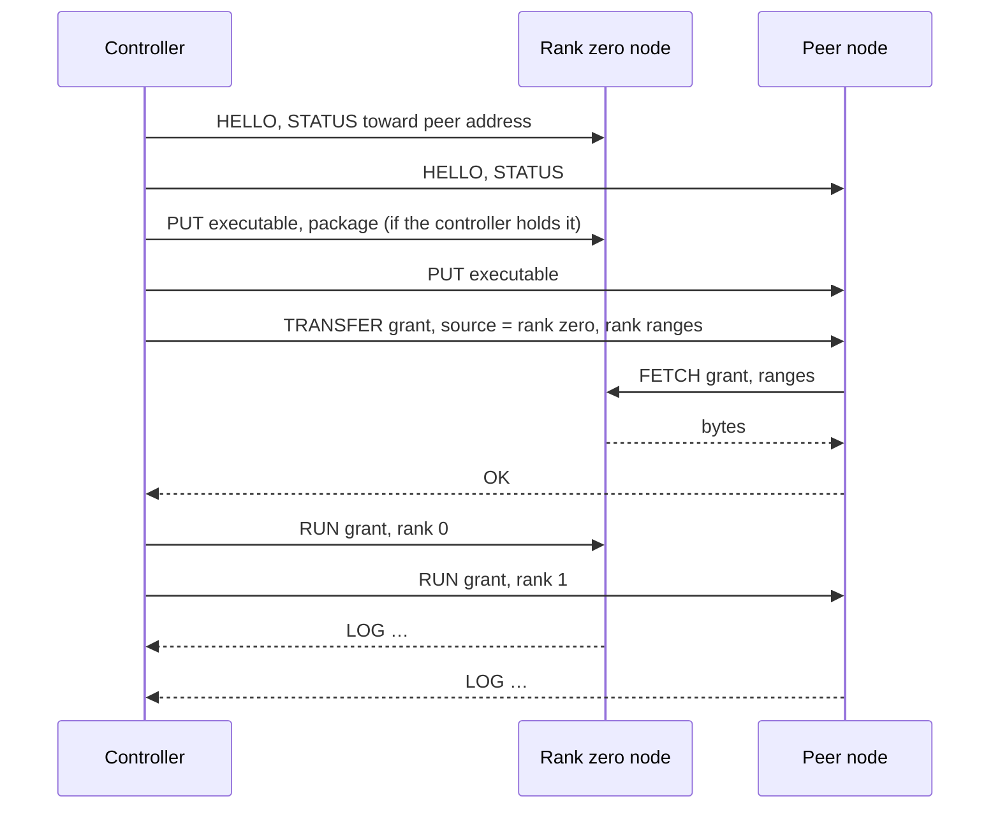

# Fleet control

A Flare fleet is a set of hosts, each running the `flare agent` service, that an
operator controls from any machine with the Flare executable. The controlling
machine is the controller. It pairs with agents, discovers them on the local
network, checks the RoCE fabric between them, prepares multi-host packages, and
starts, attaches to, and stops tensor-parallel serving groups. The controller
is not a rank: a laptop or workstation drives two or four DGX Sparks without
running a model itself.

Every host in a serving group, rank zero included, runs its rank under its
agent. The ranks keep the rendezvous, capacity agreement, and RoCEnante
transport described in [multi-host serving](multi-host.md); fleet control
decides who starts the processes and how hosts trust each other, not how ranks
execute.

This specification replaces the shared-token agent in `flare/src/agent.rs`
(protocol `flare-agent-1`, HMAC proof of `~/.config/flare/agent.token`) and the
rank-zero launcher behind `flare run --hosts`.

## Roles and identities

| Role | Runs | Identity | Authority |
| --- | --- | --- | --- |
| Node | `flare agent`, one per host, as a user service | Node key | Runs ranks and preparation under a grant from an authorized controller; serves cached files to nodes named in that grant |
| Controller | `flare fleet` commands on any host | Controller key | Pairs nodes, issues grants, attaches to groups |
| Rank zero, peer | `flare run` processes started by agents | None beyond the host | Per-launch roles assigned by the grant |

An identity is one Ed25519 key. It signs grants and controller-set records,
and it authenticates a session by signing the handshake transcript. The
fingerprint is the lowercase hex SHA-256 of the public key, the convention
publisher fingerprints in [signing](signing.md) follow. Every identity check
below compares the key a session authenticated.

| Key | Path | Created by |
| --- | --- | --- |
| Node key | `~/.config/flare/agent/node.key`, mode 0600 | `flare agent install`, or the agent's first start |
| Authorized controllers | `~/.config/flare/agent/controllers.toml` | Pairing and controller-set updates |
| Controller key | `~/.config/flare/fleet/controller.key`, mode 0600 | The first `flare fleet` command |
| Fleet file | `~/.config/flare/fleet.toml` | `flare fleet pair`, edited by the operator |

A node's name defaults to its hostname and is recorded at pairing. Renaming a
host does not change its key or its fleet entry.

## Transport

Agents listen on TCP port 29900. Every connection, controller to node and node
to node, is an encrypted, mutually authenticated session built from the `ring`
primitives Helios already links for package signatures: X25519, Ed25519,
HKDF-SHA256, and ChaCha20-Poly1305. Flare adds no dependency for it.

The handshake has three messages:

1. The initiator sends the magic `FLAREFLT`, the protocol version, and an
   ephemeral X25519 public key.
2. The responder sends its ephemeral X25519 public key, then one record
   encrypted under the responder-to-initiator key carrying its Ed25519 public
   key and a signature over the transcript so far.
3. The initiator sends one record under the initiator-to-responder key
   carrying its Ed25519 public key and a signature over the transcript
   including message 2.

Both directions' keys come from HKDF-SHA256 over the X25519 shared secret,
salted with the SHA-256 of the two ephemeral messages; each direction encrypts
with its own ChaCha20-Poly1305 key and a counter nonce. Each side signs the
transcript, so a party that relays the connection cannot present either
identity, and identities travel only encrypted. The handshake hash, the
SHA-256 of every handshake byte, is the channel binding that pairing proofs
include.

A record is a big-endian `u16` length and ciphertext of at most 65535 bytes,
so a record carries at most 65519 plaintext bytes. A frame is a tag byte, a
little-endian `u64` body length, and the body; its header starts a record and
the body continues across as many records as its length needs, so a PUT or
FETCH body of hundreds of gigabytes is one frame. Encryption bounds a transfer
to one core's ChaCha20-Poly1305 rate, so transfers to different nodes run on
separate connections in parallel.

After the handshake the agent classifies the remote key as an authorized
controller, a node named in an active grant, or unknown. Unknown keys may only
pair.

## Pairing

Pairing adds a controller's public key to a node's authorized controllers and
the node's public key and address to the controller's fleet file. A node with
no authorized controller is unpaired.

| Mode | Node command | Controller command | Authentication |
| --- | --- | --- | --- |
| Join code | `flare agent install [--join-code CODE]` | `flare fleet pair HOST... --code CODE` | Both sides prove the code inside the session; an on-path relay cannot pass |
| Accept first | `flare agent install --accept-first` | `flare fleet pair HOST...` | None; the first controller to connect is authorized |
| Delegation | None | `flare fleet controllers add KEYFILE` | Signed by an authorized controller |

`flare agent install` generates a one-time code of 20 random bytes, prints it
as eight groups of four base32 characters, and keeps the SHA-256 of the code,
the HMAC key both sides derive from it, in `~/.config/flare/agent/join-code`
for 24 hours or until a pairing uses it.
`--join-code CODE` installs a supplied code so one code covers an installation
session across several hosts. The controller's PAIR frame carries
HMAC-SHA256 of `"controller" || handshake hash` under that key; the node's OK
carries HMAC-SHA256 of `"node" || handshake hash` under it. The
handshake hash binds both proofs to this session's static keys, so a party
relaying the connection can neither impersonate the controller nor be recorded
as the node. A correct proof authorizes the controller and consumes the code.

Accept-first authorizes without a code and is never the default. It suits a
network the operator already trusts.

Delegation changes the controller set, described under
[controller set](#controller-set), so a laptop and a workstation both control
the same Sparks.

Both pairing modes print each node's name and fingerprint. The operator
compares them with what `flare agent install` printed at the host before
trusting a node for anything that moves executables. `flare fleet forget NODE`
removes a node from the fleet file; `flare agent reset` on a host removes its
authorized controllers and returns it to unpaired.

## Fleet file

```toml
# ~/.config/flare/fleet.toml
[controllers]
revision = 3

[[controllers.key]]
name = "workstation"
public_key = "a0b1…"

[[controllers.key]]
name = "laptop"
public_key = "d4e5…"

[[node]]
name = "maxwell"
fingerprint = "6f3a…"
public_key = "7943…"
address = "maxwell:29900"

[[node]]
name = "hertz"
fingerprint = "c1d2…"
public_key = "88e1…"
address = "10.100.0.13:29900"

[cluster.sparks]
nodes = ["maxwell", "hertz", "faraday", "ampere"]
```

A cluster is a named, ordered list of nodes. Its order is the rank order of
every launch and, with `--roce-ring`, the ring. `flare fleet check` proposes an
order from the measured fabric and rewrites the list after confirmation. Fleet
commands take `--cluster NAME`; a fleet with one cluster uses it by default.

## Controller set

A node's authorized controllers are one record: a revision number, the list of
controller public keys, and a signature by a key that was in the list at the
previous revision. Pairing creates revision 1 with the pairing controller
alone. `flare fleet controllers add` and `remove` write revision N+1 to the
fleet file, sign it, and send it to every node. A node applies a record only
when its revision exceeds the stored one and its signature verifies against
the stored list; HELLO carries the sender's revision, and a controller whose
record is newer than the node's sends it at the start of every session, so an
unreachable node converges when any controller connects. A controller removed
at revision N cannot produce a record at revision N+1 that any node accepts,
whatever list it carries.

## Discovery

Each agent advertises the DNS-SD service `_flare-agent._tcp.local.` through the
`mdns-sd` crate, unless started with `--no-mdns`. The TXT record carries:

| Key | Value |
| --- | --- |
| `v` | Agent protocol version |
| `fp` | Node fingerprint |
| `paired` | `0` for an unpaired node, otherwise `1` |
| `gpu` | Device name from the CUDA driver API, read without creating a context, for example `NVIDIA GB10` |
| `driver` | NVIDIA driver version |
| `free` | Free bytes under the agent cache |
| `rails` | RoCE endpoints as `roce_fabric::encode` writes them: `name address/prefix` per device with an IPv4 GID, `name -` otherwise |

`flare fleet discover` lists advertised agents for three seconds and prints
name, address, fingerprint, pairing state, GPU, and rails. `flare fleet pair`
accepts advertised names as well as hostnames and addresses. It records the
address the advertisement arrived from, which is on the network the controller
shares with the node, and confirms it by connecting; the RoCE rail addresses
in the record are never used as the agent address. A network that blocks
multicast loses only this listing; every other command works from the fleet
file.

## Frames

Frame bodies are JSON unless noted. A request receives OK with a body or ERROR
with a message; an ERROR closes the session.

| Frame | Direction | Body | Effect |
| --- | --- | --- | --- |
| HELLO | Both, first frame | Protocol version, public key, controller-set revision, node facts | Must name the key that authenticated the session; agrees on the version; a newer controller-set record follows when the sender has one |
| PAIR | Controller to node | Code proof | Authorizes the controller as described above |
| HAVE | Controller or node to node | Kind, name, size | Whether the cache holds the entry at that size |
| PUT | Controller to node | Kind, name, size, optional ranges, then bytes | Stores an executable or package bytes at their offsets in a sparse file of the package's length |
| TRANSFER | Controller to node | Grant, source node, kind, name, ranges | The node fetches those ranges from the source node and replies when stored |
| FETCH | Node to node | Grant, kind, name, ranges | Streams cached bytes to a node the grant names |
| RUN | Controller to node | Grant, rank, publisher profile | Starts this host's rank under the agent's supervision |
| ATTACH | Controller to node | Group identifier | Streams the rank's retained output, then live output |
| STOP | Controller to node | Group identifier | Sends SIGTERM to the rank |
| STATUS | Controller to node | Optional `toward` address | Running group, package, rank, uptime, cache contents, free disk, fabric endpoints, and the local address routing selects toward `toward` |
| PREPARE | Controller to node | Preparation command, checkpoint token, rank | Runs `ignition export` or `ignition join` from the node's configured checkout |
| LOG, EXIT | Node to controller | Line; exit status | Output and completion of a rank or preparation process |

Executables are stored under their SHA-256 names and run only from the cache.
Package entries hold only the bytes a rank reads, at their offsets, with
unwritten regions as sparse holes. The agent adds `--publisher-keys`,
`--dangerously-approve-key`, and `--dangerously-accept-publisher` to `flare run`
from the publisher profile in RUN: the controller performs publisher disclosure
and acceptance at its own terminal.

Cache entries are pinned by the grants that name them. Receiving an entry
evicts other entries of its kind that no active grant and no open session
pins; a source node's package therefore stays while any peer of its group may
still fetch from it.

## Grants

A grant is the controller's signed statement of one launch. Every node verifies
it against its authorized controllers before running a rank, fetching, or
serving bytes to another node.

```json
{
  "group": "sparks-20261019T153000Z-3f9c",
  "package": {"export": "…", "index_sha256": "…", "files": ["glm53-spark-tp4.safetensors"]},
  "members": [
    {"rank": 0, "name": "maxwell", "public_key": "7943…", "address": "maxwell:29900"},
    {"rank": 1, "name": "hertz", "public_key": "88e1…", "address": "10.100.0.13:29900"}
  ],
  "rendezvous": "10.100.0.12:29800",
  "serving": ["--gpus", "0", "--max-concurrency", "16"],
  "roce_ring": false,
  "issued": "2026-10-19T15:30:00Z",
  "expires": "2026-10-19T15:40:00Z"
}
```

The signature covers the canonical JSON encoding. A node accepts a RUN only
when the grant names its own key at the requested rank, has not expired, and
carries a signature from an authorized controller. The expiry bounds launch,
not serving: a group keeps running after its grant expires. Serving options
come from the grant, so every rank loads with the same options.

The grant also authorizes node-to-node transfers. A FETCH is served only to a
member of the grant, identified by the key that authenticated the session, for
the package the grant names.

The rendezvous protocol (`FLARERV3`) and the RoCE transport are unchanged and
authenticate ranks only by export identity; the grant authenticates a launch
at the agent boundary, and the ranks trust the fabric network.

## Launching a group

`flare fleet run PACKAGE --cluster sparks [serving options]` proceeds as follows.



1. The controller resolves PACKAGE. A local path is read directly. `NODE:PATH`
   or a cache name refers to a package a node holds, from which the controller
   fetches the signed index. The controller verifies the index and obtains
   publisher acceptance as `flare run` does, and computes each rank's byte
   ranges from the index with `runtime_package::rank_ranges`.
2. The controller connects to every node in the cluster, agrees on protocol
   versions, and checks STATUS for a free GPU and sufficient disk. Rank zero's
   STATUS, asked `toward` the first peer's address, returns the address rank
   zero's host uses to reach its peers; the controller places it in the grant
   as the rendezvous address.
3. The controller issues the grant with the cluster's rank order.
4. The controller ensures every node holds the executable, sending its own
   `flare` binary to nodes that lack it. The executable must be a Linux aarch64
   build; a controller on another platform supplies one with `--executable PATH`.
5. The controller ensures the package. If the controller holds it, rank zero
   receives the complete package and the shared data. If a node holds it, that
   node is the source. Each peer receives TRANSFER naming the source and its
   ranges and fetches them over the hosts' own network, in parallel. Peers
   whose package came from a node run with `--verify-weights`.
6. The controller sends RUN to every node, rank zero first. Rank zero's agent
   starts `flare run PACKAGE --rank 0 --rendezvous 0.0.0.0:PORT` with the
   grant's serving options and HTTP bind; peers start with `--rank R
   --rendezvous ZERO:PORT`.
7. The controller attaches to every node and prints output with `[rank R name]`
   prefixes, then the HTTP address rank zero serves.

Rank zero's `--host` and `--port` apply on rank zero's host; the controller
prints the resulting URL and does not proxy requests.

## Process ownership

The agent owns its rank process for the life of the process. A controller
disconnecting, sleeping, or crashing does not stop a group; the agent retains
the last 64 KiB of output per rank for a later ATTACH. `flare fleet run` stops
the group on Ctrl-C; `flare fleet run --detach` returns after startup;
`flare fleet attach CLUSTER` and `flare fleet stop CLUSTER` act on a running
group from any controller.

Stopping sends STOP to rank zero and waits for its EXIT; rank zero drains
native work and the group shuts down through its coordinated shutdown. Peers
still running 30 seconds after rank zero exits receive STOP. Peers are not
signaled while rank zero drains, because the drain needs their collectives.

The agent's systemd unit keeps the default `KillMode=control-group`: stopping,
restarting, or upgrading the agent stops the ranks it runs. Upgrade agents
between groups. Rank failure handling is unchanged: a collective timeout or
rank exit poisons the group's transport, every rank shuts down, and the agents
report EXIT. An agent does not restart ranks. One group per node runs at a
time; RUN on a busy node is refused with the running group's identifier.

## Fabric check

`flare fleet check --cluster sparks [--roce-ring]` requests each node's fabric
endpoints through STATUS and plans routes with `roce_fabric::plan_routes` or
`plan_ring_routes`, the functions serving uses. It reports, per pair of nodes,
the rails a plan would use and the endpoints that share no subnet.

It then asks every node to exercise the planned rails. The node runs the
RoCE proxy from `helios/native/roce_proxy.c` against a collective region in
registered host memory and writes the control words that GPU kernels write
during serving from the host, so the proxy posts one one-shot transfer per
rail to each planned peer. This is the method of FlashInfer's
`validate_roce_ring_native.py`, which drives the same proxy without a CUDA
context; the proxy ABI is unchanged. The check reports, per rail, whether the
transfer completed and its latency. It runs only for an authorized controller
and only on a node with no running group.

With `--roce-ring`, the check proposes the node order with a physical link
between every pair of neighbors and prints it; `--write` stores it in the
cluster. Without `--roce-ring`, the order stays as listed.

## Preparation

`flare fleet prepare RECIPE --cluster sparks [export options]` runs
`ignition export` on the cluster's first node and `ignition join` on the others
through PREPARE. Each node's `[preparation] checkout` in its own
`~/.config/flare/config.toml` names the repository checkout whose `.venv`
runs Ignition; the node reports that checkout's source identity before
starting, and the controller refuses to start when identities differ.

Ignition's peer authentication keeps its sequenced HMAC frames. The controller
generates 32 random bytes per preparation and sends them in each PREPARE
frame; the agent writes them to a private temporary file and passes it through
`--checkpoint-token-file`, a flag added to `ignition export` and
`ignition join` that overrides `[preparation] checkpoint_token_file`. The
token lives only for that preparation, and no shared token file exists on any
host. Output streams to the controller with `[rank R name]` prefixes, and the
exported package stays on rank zero's host, from where
`flare fleet run maxwell:/data/flare-runtime/glm53-spark-tp4.safetensors`
serves it.

## Commands

| Command | Where | Effect |
| --- | --- | --- |
| `flare agent install [--join-code CODE] [--accept-first] [--listen ADDR]` | Node | Writes the node key, the systemd user unit, enables linger, starts the service, prints name, fingerprint, and the join code |
| `flare agent reset` | Node | Removes authorized controllers; the node becomes unpaired |
| `flare agent --listen ADDR [--no-mdns]` | Node | Runs the service (the unit's command) |
| `flare fleet discover` | Controller | Lists advertised agents |
| `flare fleet pair HOST... [--code CODE]` | Controller | Pairs and records nodes |
| `flare fleet controllers add KEYFILE` / `remove FINGERPRINT` | Controller | Writes and distributes the next controller-set revision |
| `flare fleet check --cluster NAME [--roce-ring] [--write]` | Controller | Fabric plan and rail check; optional rank-order proposal |
| `flare fleet prepare RECIPE --cluster NAME ...` | Controller | Multi-host export through agents |
| `flare fleet run PACKAGE --cluster NAME [--detach] ...` | Controller | Starts a group and attaches |
| `flare fleet attach` / `stop` / `status --cluster NAME` | Controller | Operates a running group |

`flare run --rank R --rendezvous ADDR` remains for operator-managed starts on
hosts that already hold the executable and package. `flare run --hosts`,
`--agent-token-file`, `flare agent --token-file`, and
`[preparation] checkpoint_token_file` are removed.

## Security model

Anyone holding an authorized controller key can run code as the agent's user
on every node of the fleet. The controller key is therefore protected like the
signing key in [signing](signing.md): owner-only permissions, and an encrypted
backup if the fleet must survive losing the machine.

Packages are signed per rank. A rank whose bytes came from another node loads
with `--verify-weights`, so a compromised source node that serves tampered
weights makes that rank fail to load rather than run them. A compromised node
cannot pair other nodes, issue grants, or advance the controller set.

Removing a controller reaches nodes when any remaining controller connects;
until then the removed key can still launch on nodes it reaches. A node key is
revoked by removing the node from the fleet file, which stops future launches
but not a running group. The controller stores no secrets from nodes. Nodes
store controller public keys, their own key, and cached files. Transfers and
output are encrypted on the controller and node network; the RoCE fabric
between ranks is not.

## Compatibility

Prepared packages and their Protocol Buffers are unchanged: no re-export and no
added fields, so principle 13 of [the design review](design-review.md) is
unaffected. The rendezvous protocol and the RoCE proxy ABI are unchanged. The
agent protocol is replaced without a compatibility window: nodes and
controllers of one fleet run the same Flare revision, and `flare fleet`
refuses an agent whose HELLO reports another protocol version. The agent runs
on Linux; the controller builds wherever Flare builds.

## Delivery plan

Each step is usable on its own and leaves the previous steps working.

1. **Identity, transport, and launch from a non-member host.** Node and
   controller keys, the session transport, pairing by join code and accept-first,
   the controller-set record at revision 1, the fleet file,
   `flare agent install`, HELLO, HAVE, PUT, RUN for every rank, STOP, ATTACH,
   grants, and `flare fleet run` with the controller holding the package.
   Validation: unit tests of the handshake, grant verification, and framing
   without a network; a two-Spark GLM TP2 launch from a non-member
   x86 host whose output matches an operator-managed start.
2. **Node-to-node transfer and group operation.** TRANSFER, FETCH,
   `NODE:PATH` package sources, STATUS, `flare fleet attach` and `stop`, and
   detach survival. Validation: a four-Spark TP4 launch where only rank zero
   holds the package; a controller disconnect during serving leaves the group
   serving.
3. **Discovery and fabric check.** mDNS advertisement, `flare fleet discover`,
   fabric endpoints in STATUS, the rail check, and the ring-order proposal.
   Validation: check results agree with the rails serving selects, and a
   deliberately uncabled rail is reported before an export.
4. **Preparation through agents.** PREPARE, `flare fleet prepare`, the
   `--checkpoint-token-file` flag, and removal of
   `[preparation] checkpoint_token_file`. Validation: a GLM TP4 export through
   agents whose rank signatures verify and which serves identically to a manual
   export.
5. **Controller delegation.** Controller-set revisions above 1,
   `flare agent reset`, and record propagation in HELLO. Validation: two
   controllers on different machines operate one fleet, and a removed
   controller is refused by every node.

## Limitations

The controller does not proxy HTTP; clients reach rank zero's host directly.
A controller on a platform other than Linux aarch64 must supply the node
executable. Agents run one group per host, and restarting an agent stops its
ranks. Routing between controller and nodes uses whatever network the fleet
file addresses name; the controller does not select or configure the RoCE
fabric, interfaces, or firewalls. Discovery is link-local multicast and does
not cross routed networks. Encrypted transfers run at one core's
ChaCha20-Poly1305 rate per connection.
