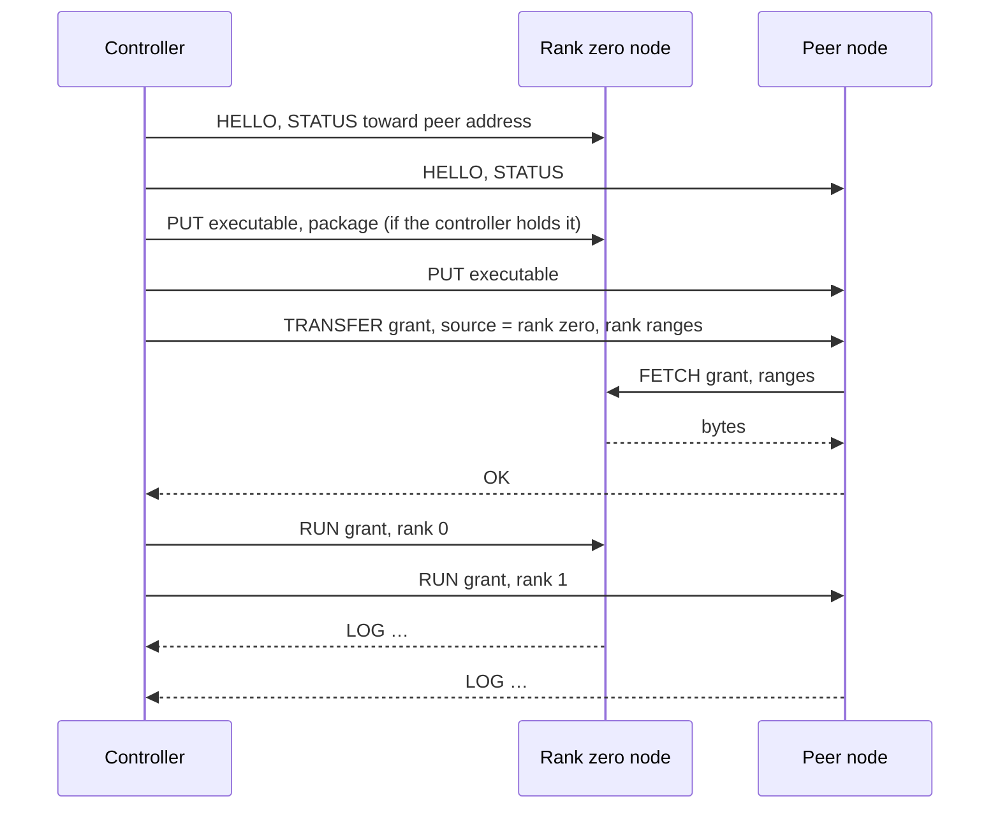

# Orbit

A Flare orbit is a set of hosts, each running the `flare agent` service, that an
operator controls from any machine with the Flare executable. The controlling
machine is the controller. It pairs with agents, discovers them on the local
network, checks the RoCE fabric between them, prepares multi-host packages, and
starts, attaches to, and stops tensor-parallel serving groups. The controller
is not a rank: a laptop or workstation drives two or four DGX Sparks without
running a model itself.

Every host in a serving group, rank zero included, runs its rank under its
agent. The ranks keep the rendezvous, capacity agreement, and RoCEnante
transport described in [multi-host serving](multi-host.md); orbit
decides who starts the processes and how hosts trust each other, not how ranks
execute.

This specification replaces the shared-token agent in `flare/src/agent.rs`
(protocol `flare-agent-1`, HMAC proof of `~/.config/flare/agent.token`) and the
rank-zero launcher behind `flare run --hosts`.

## Roles and identities

| Role | Runs | Identity | Authority |
| --- | --- | --- | --- |
| Node | `flare agent`, one per host, as a user service | Node key | Runs ranks and preparation under a grant from an authorized controller; serves cached files to nodes named in that grant |
| Controller | `flare orbit` commands on any host | Controller key | Pairs nodes, issues grants, attaches to groups |
| Rank zero, peer | `flare run` processes started by agents | None beyond the host | Per-launch roles assigned by the grant |

An identity is one Ed25519 key. It signs grants and controller-set records,
and it authenticates a session by signing the handshake transcript. The
fingerprint is the lowercase hex SHA-256 of the public key, the convention
publisher fingerprints in [signing](signing.md) follow. Every identity check
below compares the key a session authenticated.

| Key | Path | Created by |
| --- | --- | --- |
| Node key | `~/.config/flare/agent/node.key`, mode 0600 | `flare agent install`, or the agent's first start |
| Authorized controllers | `~/.config/flare/agent/controllers.toml` | Pairing and controller-set updates |
| Controller key | `~/.config/flare/orbit/controller.key`, mode 0600 | The first `flare orbit` command |
| Orbit file | `~/.config/flare/orbit.toml` | `flare orbit pair`, edited by the operator |

A node's name defaults to its hostname and is recorded at pairing. Renaming a
host does not change its key or its orbit entry.

## Transport

Agents listen on TCP port 29900. Every connection, controller to node and node
to node, is an encrypted, mutually authenticated session built from the `ring`
primitives Helios already links for package signatures: X25519, Ed25519,
HKDF-SHA256, and ChaCha20-Poly1305. Flare adds no dependency for it.

The handshake has three messages:

1. The initiator sends the magic `FLAREFLT`, the protocol version, and an
   ephemeral X25519 public key.
2. The responder sends its ephemeral X25519 public key, then one record
   encrypted under the responder-to-initiator key carrying its Ed25519 public
   key and a signature over the transcript so far.
3. The initiator sends one record under the initiator-to-responder key
   carrying its Ed25519 public key and a signature over the transcript
   including message 2.

Both directions' keys come from HKDF-SHA256 over the X25519 shared secret,
salted with the SHA-256 of the two ephemeral messages; each direction encrypts
with its own ChaCha20-Poly1305 key and a counter nonce. Each side signs the
transcript, so a party that relays the connection cannot present either
identity, and identities travel only encrypted. The handshake hash, the
SHA-256 of every handshake byte, is the channel binding that pairing proofs
include.

A record is a big-endian `u16` length and ciphertext of at most 65535 bytes,
so a record carries at most 65519 plaintext bytes. A frame is a tag byte, a
little-endian `u64` body length, and the body; its header starts a record and
the body continues across as many records as its length needs, so a PUT or
FETCH body of hundreds of gigabytes is one frame. Encryption bounds a transfer
to one core's ChaCha20-Poly1305 rate, so transfers to different nodes run on
separate connections in parallel.

After the handshake the agent classifies the remote key as an authorized
controller, a node named in an active grant, or unknown. Unknown keys may only
pair.

## Pairing

Pairing adds a controller's public key to a node's authorized controllers and
the node's public key and address to the controller's orbit file. A node with
no authorized controller is unpaired.

| Mode | Node command | Controller command | Authentication |
| --- | --- | --- | --- |
| Join code | `flare agent install [--join-code CODE]` | `flare orbit pair HOST... --code CODE` | Both sides prove the code inside the session; an on-path relay cannot pass |
| Accept first | `flare agent install --accept-first` | `flare orbit pair HOST...` | None; the first controller to connect is authorized |
| Delegation | None | `flare orbit controllers add KEYFILE` | Signed by an authorized controller |

`flare agent install` generates a one-time code of 20 random bytes, prints it
as eight groups of four base32 characters, and keeps the SHA-256 of the code,
the HMAC key both sides derive from it, in `~/.config/flare/agent/join-code`
for 24 hours or until a pairing uses it.
`--join-code CODE` installs a supplied code so one code covers an installation
session across several hosts. The controller's PAIR frame carries
HMAC-SHA256 of `"controller" || handshake hash` under that key; the node's OK
carries HMAC-SHA256 of `"node" || handshake hash` under it. The
handshake hash binds both proofs to this session's static keys, so a party
relaying the connection can neither impersonate the controller nor be recorded
as the node. A correct proof authorizes the controller and consumes the code.

Accept-first authorizes without a code and is never the default. It suits a
network the operator already trusts.

Delegation changes the controller set, described under
[controller set](#controller-set), so a laptop and a workstation both control
the same Sparks.

Both pairing modes print each node's name and fingerprint. The operator
compares them with what `flare agent install` printed at the host before
trusting a node for anything that moves executables. `flare orbit forget NODE`
removes a node from the orbit file; `flare agent reset` on a host removes its
authorized controllers and returns it to unpaired.

## Orbit file

```toml
# ~/.config/flare/orbit.toml
[controllers]
body = '{"revision":2,"keys":[{"name":"workstation","public_key":"a0b1…"},{"name":"laptop","public_key":"d4e5…"}]}'
signer = "a0b1…"
signature = "4665…"

[[node]]
name = "maxwell"
fingerprint = "6f3a…"
public_key = "7943…"
address = "maxwell:29900"

[[node]]
name = "hertz"
fingerprint = "c1d2…"
public_key = "88e1…"
address = "10.100.0.13:29900"

[cluster.sparks]
nodes = ["maxwell", "hertz", "faraday", "ampere"]
```

`controllers` is the signed controller-set record exactly as nodes store it:
the JSON body the signer serialized, the signer's public key, and the
signature, so a node verifies the same bytes the orbit file holds. Pairing
writes revision 1; `flare orbit controllers` writes later revisions. The
operator adds clusters by hand.

A cluster is a named, ordered list of nodes. Its order is the rank order of
every launch and, with `--roce-ring`, the ring. `flare orbit check` proposes an
order from the measured fabric and rewrites the list after confirmation. Orbit
commands take `--cluster NAME`; an orbit with one cluster uses it by default.

## Controller set

A node's authorized controllers are one record: a revision number, the list of
controller public keys, and a signature by a key that was in the list at the
previous revision. Pairing creates revision 1 with the pairing controller
alone. `flare orbit controllers add` and `remove` write revision N+1 to the
orbit file, sign it, and send it to every node. A node applies a record only
when its revision exceeds the stored one and its signature verifies against
the stored list; HELLO carries the sender's revision, and a controller whose
record is newer than the node's sends it at the start of every session, so an
unreachable node converges when any controller connects. A controller removed
at revision N cannot produce a record at revision N+1 that any node accepts,
whatever list it carries.

## Discovery

Each agent advertises the DNS-SD service `_flare-agent._tcp.local.` through the
`mdns-sd` crate, unless started with `--no-mdns`. The TXT record carries:

| Key | Value |
| --- | --- |
| `v` | Agent protocol version |
| `fp` | Node fingerprint |
| `paired` | `0` for an unpaired node, otherwise `1` |
| `gpu` | Device name from the CUDA driver API, read without creating a context, for example `NVIDIA GB10` |
| `driver` | NVIDIA driver version |
| `free` | Free bytes under the agent cache |
| `rails` | RoCE endpoints as `roce_fabric::encode` writes them: `name address/prefix` per device with an IPv4 GID, `name -` otherwise |

`flare orbit discover` lists advertised agents for three seconds and prints
name, address, fingerprint, pairing state, GPU, and rails. `flare orbit pair`
accepts advertised names as well as hostnames and addresses. It records the
address the advertisement arrived from, which is on the network the controller
shares with the node, and confirms it by connecting; the RoCE rail addresses
in the record are never used as the agent address. A network that blocks
multicast loses only this listing; every other command works from the orbit
file.

## Frames

Frame bodies are JSON unless noted. A request receives OK with a body or ERROR
with a message; an ERROR closes the session.

| Frame | Direction | Body | Effect |
| --- | --- | --- | --- |
| HELLO | Both, first frame | Protocol version, public key, controller-set revision, node facts | Must name the key that authenticated the session; agrees on the version; a newer controller-set record follows when the sender has one |
| PAIR | Controller to node | Code proof | Authorizes the controller as described above |
| HAVE | Controller or node to node | Kind, name, size | Whether the cache holds the entry at that size |
| PUT | Controller to node | Kind, name, size, optional ranges, then bytes | Stores an executable or package bytes at their offsets in a sparse file of the package's length |
| CONTROLLERS | Controller to node | Signed controller-set record | Applies a higher revision signed by a current member |
| TRANSFER | Controller to node | Grant, publisher profile, source node, cache directory, files with sizes and ranges | The node fetches those ranges from the source node into its cache, verifies the directory's stored data unless it verified before, and replies when done; a push's grant authorizes transfers alone |
| FETCH | Node to node | Grant, file name, ranges | Streams the file's bytes to a node the grant names, from the package the node holds or its cache |
| GET | Controller to node | Absolute path, offset, length | Streams up to 256 MiB of a node-local file, used to mirror a package's header and index |
| STAT | Controller to node | Absolute path | The package file's size and its companions' names and sizes |
| RUN | Controller to node | Grant, rank, executable name, publisher profile | Starts this host's rank on the GPUs the grant's member names, beside other groups on other GPUs, then streams LOG and EXIT |
| ATTACH | Controller to node | Group identifier, required when several groups are on the node | Streams the rank's retained output, then live output |
| STOP | Controller to node | Group identifier, required when several groups are on the node | Sends SIGTERM to the rank |
| STATUS | Controller to node | Optional `toward` address | Name, keys, controller-set revision, free cache space, every GPU with its UUID, revision, memory and holding group, every group the agent runs or retains with its name, rank, GPUs, state and uptime, every package cache directory with its files and verification state, and the local address routing selects toward `toward` |
| METRICS | Controller to node | None | The GPUs as the agent's sampler last read them, with utilization, temperature, clock and holding group, and every group with the metrics document its rank-zero process last served |
| PREPARE | Controller to node | Preparation command, checkpoint token, rank | Runs `ignition export` or `ignition join` from the node's configured checkout (see [unimplemented parts](#unimplemented-parts)) |
| LOG, EXIT | Node to controller | Line; exit status | Output and completion of a rank or preparation process |

Executables are stored under their SHA-256 names and run only from the cache.
Package entries hold only the bytes a rank reads, at their offsets, with
unwritten regions as sparse holes. The agent adds `--publisher-keys`,
`--dangerously-approve-key`, and `--dangerously-accept-publisher` to `flare run`
from the publisher profile in RUN: the controller performs publisher disclosure
and acceptance at its own terminal.

Cache entries are pinned by the grants that name them. Receiving an entry
evicts other entries of its kind that no active grant and no open session
pins; a source node's package therefore stays while any peer of its group may
still fetch from it.

## Grants

A grant is the controller's signed statement of one launch. Every node verifies
it against its authorized controllers before running a rank, fetching, or
serving bytes to another node.

```json
{
  "group": "sparks-20261019T153000Z-3f9c",
  "package": {
    "export": "…",
    "length": 2122414256,
    "files": ["glm53-spark-tp4.safetensors"],
    "source": {"public_key": "7943…", "path": "/data/flare-runtime/glm53-spark-tp4.safetensors"}
  },
  "name": "ds41",
  "members": [
    {"rank": 0, "name": "maxwell", "public_key": "7943…", "address": "maxwell:29900", "gpus": ["GPU-…"]},
    {"rank": 1, "name": "hertz", "public_key": "88e1…", "address": "10.100.0.13:29900", "gpus": ["GPU-…"]}
  ],
  "rendezvous": "10.100.0.12:29800",
  "serving": ["--gpus", "0", "--max-concurrency", "16"],
  "rank_zero": ["--host", "0.0.0.0", "--port", "8000"],
  "roce_ring": false,
  "issued": 1792420200,
  "expires": 1792420800
}
```

`name` is the operator's name for the group, stable across launches, by which
`attach`, `stop`, and `ls` find it. A member's `gpus` are the UUIDs of the GPUs
its rank uses; the agent exposes exactly those through `CUDA_VISIBLE_DEVICES`
and refuses a grant whose GPUs a running group holds. An empty list leaves the
GPUs to the rank and excludes every other group from the node.
`package.length` is the primary file's size, which names cache entries
together with `export`. `source` names the node holding the package and is
absent when the controller holds it. `issued` and `expires` are Unix seconds;
a grant authorizes RUN for ten minutes, and the controller signs the grant
again before RUN when transfers outlast that.

The signature covers the canonical JSON encoding. A node accepts a RUN only
when the grant names its own key at the requested rank, has not expired, and
carries a signature from an authorized controller. The expiry bounds launch,
not serving: a group keeps running after its grant expires. Serving options
come from the grant, so every rank loads with the same options.

The grant also authorizes node-to-node transfers. A FETCH is served only to a
member of the grant, identified by the key that authenticated the session, for
the package the grant names.

The rendezvous protocol (`FLARERV3`) and the RoCE transport are unchanged and
authenticate ranks only by export identity; the grant authenticates a launch
at the agent boundary, and the ranks trust the fabric network.

## Launching a group

`flare orbit run PACKAGE [--cluster NAME | --nodes NODE,...] [--name NAME]
[serving options]` proceeds as follows, after [placement](#placement) has
chosen the member nodes and their GPUs.



1. The controller resolves PACKAGE. A local path is read directly. `NODE:PATH`
   refers to a package a node holds, from which the controller fetches the
   safetensors header, the signed index, and each companion's header into a
   sparse mirror. The controller verifies the index and obtains
   publisher acceptance as `flare run` does, and computes each rank's byte
   ranges from the index with `runtime_package::rank_ranges`.
2. The controller connects to every node in the cluster, agrees on protocol
   versions, and checks STATUS for a free GPU and sufficient disk. Rank zero's
   STATUS, asked `toward` the first peer's address, returns the address rank
   zero's host uses to reach its peers; the controller places it in the grant
   as the rendezvous address.
3. The controller issues the grant with the cluster's rank order.
4. The controller ensures every node holds the executable, sending its own
   `flare` binary to nodes that lack it. The executable must be a Linux aarch64
   build; a controller on another platform supplies one with `--executable PATH`.
5. The controller ensures the package. If the controller holds it, rank zero
   receives the complete package and the shared data. If a node holds it, that
   node is the source. Each peer receives TRANSFER naming the source and its
   ranges and fetches them over the hosts' own network, in parallel. A node
   then digests the directory's stored data against the signed index, removes
   the directory if any byte differs, and otherwise writes a marker in it; a
   later TRANSFER into a marked directory that needs no bytes verifies
   nothing, and a PUT or fetch into it removes the marker first.
6. The controller sends RUN to every node, rank zero first. Rank zero's agent
   starts `flare run PACKAGE --rank 0 --rendezvous 0.0.0.0:PORT` with the
   grant's serving options and HTTP bind; peers start with `--rank R
   --rendezvous ZERO:PORT`.
7. The controller attaches to every node and prints output with `[rank R name]`
   prefixes, then the HTTP address rank zero serves.

Rank zero's `--host` and `--port` apply on rank zero's host; the controller
prints the resulting URL and does not proxy requests.

## Process ownership

The agent owns its rank process for the life of the process. A controller
disconnecting, sleeping, or crashing does not stop a group; the agent retains
the last 64 KiB of output per rank for a later ATTACH. `flare orbit run` stops
the group on Ctrl-C; `flare orbit run --detach` returns after startup;
`flare orbit attach CLUSTER` and `flare orbit stop CLUSTER` act on a running
group from any controller.

Stopping sends STOP to rank zero and waits for its EXIT; rank zero drains
native work and the group shuts down through its coordinated shutdown. Peers
still running 30 seconds after rank zero exits receive STOP. Peers are not
signaled while rank zero drains, because the drain needs their collectives.

The agent's systemd unit keeps the default `KillMode=control-group`: stopping,
restarting, or upgrading the agent stops the ranks it runs. Upgrade agents
between groups. Rank failure handling is unchanged: a collective timeout or
rank exit poisons the group's transport, every rank shuts down, and the agents
report EXIT. An agent does not restart ranks. Several groups run under one
agent on disjoint GPUs, as [GPUs and groups](#gpus-and-groups) describes.

## GPUs and groups

The unit of capacity is a GPU, not a host. A DGX Spark is a node with one
GPU; a workstation with sixteen RTX PRO 6000 GPUs is a node with sixteen,
running one agent. The agent reads its GPUs through NVML, loaded dynamically
like the CUDA driver, without creating a context: index, UUID, name, hardware
revision (`gb10`, `gb202`, `gb300` from the PCI device id or compute
capability), memory total and free, and utilization, memory-controller
utilization (the share of the sample period the memory controller was busy,
which approximates the share of peak memory bandwidth in use), temperature and
SM clock where NVML reports them. A GB10 reports host memory, since NVML has
no device memory for it, and reports no utilization of either kind or
temperature; its firmware exposes no memory-fabric counters and NVIDIA's
counter sampling offers it no bandwidth metric, so a GB10's memory traffic is
only known from what the model declares it reads.

STATUS carries three lists beside the node's identity and free cache space.

| List | Entry |
| --- | --- |
| `gpus` | Index, UUID, name, revision, memory total and free, utilization, temperature and SM clock where present, and the running group holding the GPU, if any |
| `groups` | Every group the agent runs or retains, oldest first: identifier, name, package, rank, GPUs, pid, state, exit status, uptime |
| `packages` | Every cache directory: name, files with sizes, whether its stored data verified, bytes on disk |

A group has a name the operator chooses with `--name`, defaulting to the
cluster's name, stable across launches; its identifier is unique per launch.
A grant's member names the UUIDs its rank uses, and the agent exposes exactly
those through `CUDA_VISIBLE_DEVICES` with `--gpus 0..n`, refuses a GPU the
node lacks or one a running group holds, and otherwise runs the group beside
the others, each a separate process with its own retained output. A member
naming no GPUs takes the whole node. The agent keeps the sixteen most recent
finished groups; STOP and ATTACH name a group when several are on the node.
`flare orbit ls` lists every group on a cluster's nodes with its GPUs and
state, and `attach` and `stop` take a group name or identifier.

A package is one of two kinds, and the package says which. A multi-host
package of N ranks needs N nodes, each giving its rank one GPU, and runs over
RoCEnante. A single-host tensor-parallel package of N ranks needs one node
with N free GPUs and runs as one process over PCIe collectives; its grant
names one member with those GPUs and `single_host`, and the agent starts it
without a rank or rendezvous. [Placement](#placement) chooses the nodes and
GPUs of either kind.

## Desired state

The orbit file may describe the groups the operator wants:

```toml
[[group]]
name = "ds41"
package = "maxwell:/data/flare-runtime/deepseek-tp4.safetensors"
serving = ["--max-concurrency", "16", "--mtp-draft-tokens", "5"]
rank_zero = ["--host", "0.0.0.0", "--port", "8000"]

[[group]]
name = "glm-a"
package = "maxwell:/data/flare-runtime/glm53-tp2.safetensors"
nodes = ["maxwell", "hertz"]
```

`flare orbit run --name ds41` takes the package from the group of that name
when the command names none, puts the group's `serving` words before the
command line's serving options so the command line overrides them, puts the
group's `rank_zero` words after the command line's bind options so the group
decides where rank zero listens, and takes `nodes`, `gpus`, and `roce_ring`
as constraints when the command line gives none. `nodes` lists candidate
nodes in rank order; `gpus` lists the NVML indices every member uses on its
node. A group without them is placed from the whole orbit.

## Placement

`flare orbit run` places a package on the candidate nodes: those `--nodes`
lists, else the cluster `--cluster` names, else the group's `nodes`, else
every node of the orbit that answers STATUS. The planner turns the package's
needs, read from its signed index, and the nodes' STATUS reports into
members with GPUs, or an explanation naming the node or GPU that cannot
serve. It applies these rules in order:

1. Only GPUs whose revision equals the package's are candidates.
2. A GPU is free when no running group holds it and its free memory covers
   the rank's recorded device bytes plus the package's serving reserve.
3. A multi-host package takes one node per rank; a single-host package takes
   its rank count of free GPUs on one node, the set with the most adjacent
   indices and the lowest indices on ties, or exactly the indices `gpus`
   names.
4. With a candidate list, its order is the rank order: rank r takes the
   earliest listed node after rank r−1's that can serve it. Without one, rank
   zero prefers the node holding the complete package verified or the node
   the `NODE:PATH` reference names, and every other rank prefers a node whose
   cache holds its rank verified; ties go to the GPU with the most free
   memory, then the node name. When that greedy choice leaves a rank without
   a node, earlier ranks are reassigned, so the planner fails only when no
   assignment exists.
5. On a node, a rank takes the lowest-index free GPU of the right revision.

While the controller reads the nodes and places the group, a terminal shows
the orbit banner, the wordmark above Flare's sun with a body circling it for
one revolution of three seconds; the final frame stays above the placement.
The controller prints the placement, one member per line with its node, GPU
and whether the node already holds its rank, before transferring anything.
`--dry-run` stops there. The planner does not set `--memory-limit` for a
group, so two groups sharing a node's GPUs divide memory as the operator's
serving options say, and it does not check ring adjacency, so a ring package
takes the listed order.

## Prestaging

`flare orbit push PACKAGE --to NODE...` places a package on nodes ahead of
any launch and verifies it there, under a grant whose group starts nothing
and sends no executable. With one node per rank, each node receives its
rank's bytes in the listed order, as a launch would place them; with any
other number of nodes, each receives the complete package, which serves rank
zero of a multi-host package or a single-host package entirely. A node that
holds the package outside its cache is skipped. `flare orbit packages` lists
every node's cache directories with their file counts, bytes on disk and
verification state. A launch whose ranks are already staged and verified
starts without transfers.

## Metrics and the dashboard

A sampler thread in the agent reads the GPUs once a second and, for every
running group whose rank zero it hosts, fetches that process's `/metrics`
document as JSON from the loopback address of its HTTP bind. METRICS returns
the latest GPU readings with their holding groups and every group with its
latest document.

`flare orbit dashboard [--cluster NAME]` polls METRICS on every node of the
cluster twice a second, reconnecting to a node that stops answering, and
draws the serving process's terminal dashboard for the orbit through the view
Helios exports: one row per group with prefill and generation rates, active
and queued requests, acceptance, weight bandwidth (verification steps per
second times the decode weight bytes the package declares, or a dash when it
declares none) and KV tokens; the four plots of the selected
group, derived from successive documents with the same rate history the
serving dashboard uses; and one row per GPU with utilization, memory-controller
utilization, free memory, temperature and the group holding it. Groups and nodes appear and disappear
as the agents report them, a node that stops answering is shown as
unreachable until it answers again, the arrow keys select the group, and `q`
leaves.

## Fabric check

`flare orbit check --cluster sparks [--roce-ring]` requests each node's fabric
endpoints through STATUS and plans routes with `roce_fabric::plan_routes` or
`plan_ring_routes`, the functions serving uses. It reports, per pair of nodes,
the rails a plan would use and the endpoints that share no subnet.

It then asks every node to exercise the planned rails. The node runs the
RoCE proxy from `helios/native/roce_proxy.c` against a collective region in
registered host memory and writes the control words that GPU kernels write
during serving from the host, so the proxy posts one one-shot transfer per
rail to each planned peer. This is the method of FlashInfer's
`validate_roce_ring_native.py`, which drives the same proxy without a CUDA
context; the proxy ABI is unchanged. The check reports, per rail, whether the
transfer completed and its latency. It runs only for an authorized controller
and only on a node with no running group.

With `--roce-ring`, the check proposes the node order with a physical link
between every pair of neighbors and prints it; `--write` stores it in the
cluster. Without `--roce-ring`, the order stays as listed.

## Preparation

`flare orbit prepare RECIPE --cluster sparks [export options]` runs
`ignition export` on the cluster's first node and `ignition join` on the others
through PREPARE. Each node's `[preparation] checkout` in its own
`~/.config/flare/config.toml` names the repository checkout whose `.venv`
runs Ignition; the node reports that checkout's source identity before
starting, and the controller refuses to start when identities differ.

Ignition's peer authentication keeps its sequenced HMAC frames. The controller
generates 32 random bytes per preparation and sends them in each PREPARE
frame; the agent writes them to a private temporary file and passes it through
`--checkpoint-token-file`, a flag added to `ignition export` and
`ignition join` that overrides `[preparation] checkpoint_token_file`. The
token lives only for that preparation, and no shared token file exists on any
host. Output streams to the controller with `[rank R name]` prefixes, and the
exported package stays on rank zero's host, from where
`flare orbit run maxwell:/data/flare-runtime/glm53-spark-tp4.safetensors`
serves it.

## Commands

| Command | Where | Effect |
| --- | --- | --- |
| `flare agent install [--join-code CODE] [--accept-first] [--listen ADDR]` | Node | Writes the node key, the systemd user unit, enables linger, starts the service, prints name, fingerprint, and the join code |
| `flare agent reset` | Node | Removes authorized controllers; the node becomes unpaired |
| `flare agent --listen ADDR [--no-mdns]` | Node | Runs the service (the unit's command) |
| `flare orbit discover` | Controller | Lists advertised agents (unimplemented) |
| `flare orbit pair HOST... [--code CODE]` | Controller | Pairs and records nodes |
| `flare orbit controllers add KEYFILE` / `remove FINGERPRINT` | Controller | Writes and distributes the next controller-set revision |
| `flare orbit check --cluster NAME [--roce-ring] [--write]` | Controller | Fabric plan and rail check; optional rank-order proposal (unimplemented) |
| `flare orbit prepare RECIPE --cluster NAME ...` | Controller | Multi-host export through agents (unimplemented) |
| `flare orbit run [PACKAGE] [--cluster NAME \| --nodes NODE,...] [--name GROUP] [--gpus N,...] [--dry-run] [--detach] ...` | Controller | Places a group on the candidate nodes' GPUs, starts it and attaches; `--dry-run` prints the placement only |
| `flare orbit ls [--cluster NAME]` | Controller | Every group on the cluster's nodes with its GPUs and state |
| `flare orbit dashboard [--cluster NAME]` | Controller | The serving process's live metrics dashboard for every group and GPU of the cluster |
| `flare orbit attach [GROUP]` / `stop [GROUP]` / `status --cluster NAME` | Controller | Operates running groups, or the one named |
| `flare orbit forget NODE` | Controller | Removes a node from the orbit file |
| `flare orbit push PACKAGE --to NODE,...` | Controller | Places and verifies a package on nodes without starting it |
| `flare orbit packages [--cluster NAME]` | Controller | Every node's cache directories with their verification state |

`flare run --rank R --rendezvous ADDR` remains for operator-managed starts on
hosts that already hold the executable and package. `flare run --hosts`,
`--agent-token-file`, and `flare agent --token-file` are removed;
`[preparation] checkpoint_token_file` remains until PREPARE replaces it.

## Security model

Anyone holding an authorized controller key can run code as the agent's user
on every node of the orbit. The controller key is therefore protected like the
signing key in [signing](signing.md): owner-only permissions, and an encrypted
backup if the orbit must survive losing the machine.

Packages are signed per rank. An agent digests bytes fetched from another node
against the signed index before it will run them and keeps the result with the
cache directory, so a compromised source node that serves tampered weights
makes the transfer fail rather than a rank run them. Bytes the controller
sends with PUT are the controller's own and are not digested on the node;
`--verify-weights` makes every rank digest its stored data at load. A
compromised node cannot pair other nodes, issue grants, or advance the
controller set.

Removing a controller reaches nodes when any remaining controller connects;
until then the removed key can still launch on nodes it reaches. A node key is
revoked by removing the node from the orbit file, which stops future launches
but not a running group. The controller stores no secrets from nodes. Nodes
store controller public keys, their own key, and cached files. Transfers and
output are encrypted on the controller and node network; the RoCE fabric
between ranks is not.

## Compatibility

Prepared packages and their Protocol Buffers are unchanged: no re-export and no
added fields, so principle 13 of [the design review](design-review.md) is
unaffected. The rendezvous protocol and the RoCE proxy ABI are unchanged. The
agent protocol is replaced without a compatibility window: nodes and
controllers of one orbit run the same Flare revision, and `flare orbit`
refuses an agent whose HELLO reports another protocol version. The agent runs
on Linux; the controller builds wherever Flare builds.

## Unimplemented parts

Identity, the session transport, pairing, the controller set and its
propagation, the orbit file, grants, executable and package placement with
node-to-node fetches, GPU inventory and several groups per agent, placement
with desired state in the orbit file, the metrics sampler and the orbit
dashboard, `flare agent install` and `reset`, and `flare orbit pair`,
`controllers`, `status`, `ls`, `dashboard`, `run`, `attach`, `stop`, and
`forget` exist and are validated by unit tests and by serving a four-rank
package on four DGX Sparks from a controller that is not a rank. The
following parts of this specification are not in the tree, and the
[proposal](#proposal-reconciliation) describes reconciliation:

1. **Discovery and fabric check.** mDNS advertisement, `flare orbit discover`,
   fabric endpoints in STATUS, the rail check, and the ring-order proposal.
   Validation: check results agree with the rails serving selects, and a
   deliberately uncabled rail is reported before an export.
2. **Preparation through agents.** PREPARE, `flare orbit prepare`, the
   `--checkpoint-token-file` flag, and removal of
   `[preparation] checkpoint_token_file`. Validation: a GLM TP4 export through
   agents whose rank signatures verify and which serves identically to a manual
   export.

## Proposal: reconciliation

This section proposes the next form of orbit. Nothing in it is in the
tree.

### Reconciliation

`flare orbit apply` compares the orbit file's groups with what the agents
report and produces a plan: groups to stop because the file no longer lists
them or their package or options changed, groups to start, and the placement
of each. It stops before it starts, so freed GPUs are available to the
planner, prints the plan, and executes it in that order; `--dry-run` prints
only. `run`, `stop`, and `push` remain the primitives it is built from and
stay available by hand.

### Commands

| Command | Effect |
| --- | --- |
| `flare orbit apply [--dry-run]` | Reconciles the orbit file's groups with the agents |

### Unchanged

Identity, the session transport, pairing, the controller set, grants as the
authority for every launch and transfer, verification of fetched bytes in the
agent, placement, prestaging, the sampler and the dashboard, and one rank zero per group
chosen by placement. There is no scheduler service, no lease, and no
consensus; two controllers driving one pool see the same actual state from
the agents and the same desired state when they share a orbit file.

### Order of work

1. `apply` with plan and dry-run.

## Limitations

The controller does not proxy HTTP; clients reach rank zero's host directly.
A controller on a platform other than Linux aarch64 must supply the node
executable. Agents run one group per host, and restarting an agent stops its
ranks. Routing between controller and nodes uses whatever network the orbit
file addresses name; the controller does not select or configure the RoCE
fabric, interfaces, or firewalls. Discovery is link-local multicast and does
not cross routed networks. Encrypted transfers run at one core's
ChaCha20-Poly1305 rate per connection.
