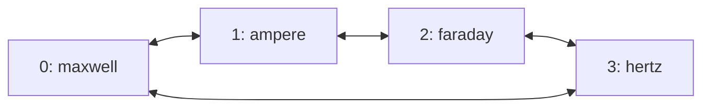

# RoCE ring transport

Flare's experimental `--roce-ring` option connects each tensor-parallel rank to
its neighbors in rank order. A native CPU proxy forwards transfers addressed to
other ranks through those neighbors. The transport supports 2 through 16 ranks;
each model recipe still determines which tensor-parallel sizes it can prepare.
GLM-5.3 Flash and Qwen3.8 Flash prepare multi-host TP2 and TP4 packages.

Ring routing applies to RoCEnante's one-shot reductions, two-shot reductions,
and variable-length gathers. The collective algorithms and arithmetic remain
in the prepared GPU programs. Routing, registered relay buffers, and RDMA
progress belong to the native transport. Serving has no Python callback,
runtime compilation, or steady-state GPU allocation.

The ring can run over a switch or hosts cabled directly to their neighbors.
Forwarding runs on host CPUs; ConnectX hardware hairpin forwarding is not
implemented. Four-Spark transport checks pass on a switched fabric. Physical
ring cabling and full-model ring serving remain unqualified.

## Rank order and routes

Ranks form the cycle `0,1,...,N-1,0`. Rank zero is the launching host, and
`flare run --hosts` lists the remaining hosts in rank order. During preparation,
each peer's `ignition join --rank` assigns the corresponding position.

For example, launch on `maxwell` with `--hosts ampere,faraday,hertz`:



Only neighboring queue pairs connect. A transfer to a neighbor uses a direct
RDMA write. A transfer to another rank follows the shorter direction around the
cycle; equal-length paths follow increasing rank numbers, wrapping at N.

| Transfer | Path | Forwarding |
| --- | --- | --- |
| Rank 0 to rank 1 | `0 → 1` | Direct |
| Rank 0 to rank 3 | `0 → 3` | Direct |
| Rank 0 to rank 2 | `0 → 1 → 2` | Rank 1 relays the transfer |
| Rank 1 to rank 3 | `1 → 2 → 3` | Rank 2 relays the transfer |

Two ranks have one distinct neighbor each; three or more have two. A switch
does not add direct connections between non-neighbors in ring mode.

Each serving host discovers its active RoCEv2 devices. Ranks exchange device
endpoints and plan up to two rails per neighbor. On a switched fabric, matching
device indexes carry the rails when their addressing permits it. With direct
cables, the planner pairs local and remote devices on a common IPv4 subnet.
It discovers at most four devices per host, allowing the two PCIe functions of
each cabled Spark port to participate. Every neighbor must have enough reachable
links for the selected rail count.

Flare does not configure interfaces, addresses, cables, switch forwarding, or
firewall rules. A physical ring needs both neighbor links and suitable RoCEv2
addressing already configured.

## Transfer progress and buffer ownership

Captured GPU kernels exchange data through a registered host region whose
layout and address are recorded in the package. Kernels stage payloads and
publish readiness words; the proxy posts RDMA writes and publishes the flags
that receiving kernels wait for. The proxy performs transport work, not the
model's reductions.

Ring mode also allocates about 2.01 MiB of registered host memory per rank at
startup. This fixed-capacity region contains relay mailboxes, acknowledgment
words, and outgoing descriptors for up to 16 origins and two rails. It is
separate from captured graph storage and the package's collective region.
Relay payloads occupy at most 64 KiB per packet.

A transfer from rank 0 to rank 2 through rank 1 proceeds as follows:

1. Rank 0's proxy splits each rail's payload into bounded packets. It writes a
   packet into rank 1's mailbox reserved for origin 0 and that rail, then
   publishes the packet's serial number after its payload and descriptor.
2. Rank 1's proxy observes the serial number and validates the destination,
   bounds, and progress toward the destination. For a longer path, it forwards
   the packet to the next relay's mailbox. In this example, rank 2 is already
   its neighbor, so it writes directly into rank 2's collective region.
3. The final payload write is ordered before the destination's readiness flag.
   The last relay waits for its send completion, then acknowledges the packet
   to the preceding hop. Longer paths pass acknowledgments back through each
   relay to the origin.
4. Rank 0 waits for that acknowledgment before submitting its next packet on
   the same rail. Relay buffers and outgoing descriptors remain live until
   downstream acknowledgment permits reuse.

The acknowledgment protects data still being read by a NIC. Receiving GPU
programs consume data through their collective readiness flags and sequence
protocol; a relay acknowledgment does not mean the destination GPU has finished
using the payload.

Every origin has separate mailbox credit on each rail. A stalled origin does
not hold another origin's mailbox. While waiting for credit or completions, the
proxy also progresses incoming relay work. Packets advance toward their
destination rather than circulating indefinitely.

Two-shot reductions need a further lifetime boundary. After posting its
all-gather writes, the proxy waits until its own sends have completed before
publishing `pipe_done`. The GPU kernel waits for that sequence before advancing
the epoch that permits the next operation to overwrite `pipe_send`. Receiving
every peer's output alone does not release a rank's own send buffer.

## Preparation and serving

Follow the [multi-host requirements and agent setup](multi-host.md#requirements)
first. Use the same Flare revision and locked preparation dependencies on every
host. From each checkout root:

```sh
uv sync --locked --extra prepare --extra test
cargo build --release --manifest-path flare/Cargo.toml
```

Preparation and serving use proxy ABI 9. Packages prepared with an earlier RoCE
proxy ABI require re-export; startup rejects a mismatch before replay.

### Prepare across four hosts

On `maxwell`, choose an unused output filename and an available rendezvous port:

```sh
.venv/bin/ignition export glm-5.3-flash --gpus 0 --ranks 4 \
  --rendezvous maxwell:29630 --roce-ring --max-concurrency 4 \
  --output /data/flare-runtime/glm53-ring-tp4.safetensors --verbose
```

Run the corresponding command on each peer from its checkout root:

```sh
# ampere: rank 1
.venv/bin/ignition join maxwell:29630 --rank 1 --ranks 4

# faraday: rank 2
.venv/bin/ignition join maxwell:29630 --rank 2 --ranks 4

# hertz: rank 3
.venv/bin/ignition join maxwell:29630 --rank 3 --ranks 4
```

Rank zero sends the preparation option to peers. The plan records `roce_ring`,
and the package cache key includes it. `ignition serve` also accepts the option
with `--ranks` for development without package export.

### Serve through peer agents

On `maxwell`:

```sh
./flare/target/release/flare run /data/flare-runtime/glm53-ring-tp4.safetensors \
  --hosts ampere,faraday,hertz --gpus 0 --roce-ring \
  --host 127.0.0.1 --port 8001
```

Rank zero forwards `--roce-ring` to every agent-started rank. If starting peers
manually, pass it to every rank along with the usual rank and rendezvous options.
Ranks that disagree about ring mode fail during transport record exchange.

Select ring mode explicitly during serving, including for a package prepared
with the option. The serving flag chooses routing independently of the
package's graph catalog. A compatible ABI 9 package can use either transport
without changing its captured addresses or collective algorithms. Preparation
on a physical ring also needs `--roce-ring`, because non-neighbor direct routes
are unavailable during warmup and capture.

## Validation and limits

FlashInfer provides a CPU-driven validator at
`tests/experimental/b12x/comm/validate_roce_ring_native.py`. It drives the real
C proxy through the collective region without creating a CUDA context. The
validator checks every byte of mixed one-shot, two-shot, and variable-length
transfers, including empty contributions, unequal shards, and buffer reuse.

From a matching FlashInfer checkout, run one process on each host. For example,
on `maxwell`:

```sh
python3 tests/experimental/b12x/comm/validate_roce_ring_native.py \
  --rank 0 --world-size 4 --rendezvous maxwell:29783 \
  --iterations 120 --skew-rank 2
```

Run the same command on `ampere`, `faraday`, and `hertz`, changing `--rank` to
1, 2, and 3 respectively. `--skew-rank 2` delays one sender; keep it identical
on all four commands. The default HCA names and GID index match the switched
Spark lab. Other fabrics must supply their own `--hca-names` and `--gid-index`.
Add `--mesh` on every rank to validate ordinary direct routing.

The vendored Flare proxy passes 120 mixed operations per rank in ring mode and
60 in mesh mode on the four Sparks, each with sender skew and byte-exact output
checks. Ring counters report two connected neighbors per rank and forwarded
packets; mesh counters report three connected peers and no forwarded packets.
Route-planning unit tests cover physical and switched endpoint layouts through
16 ranks.

These checks establish native transport progress and byte integrity on the
switched fabric. Physical ring cabling, full-model CUDA graph serving, relay
faults during GPU replay, and ring throughput remain unqualified. CPU relay
work, extra RDMA hops, and per-packet acknowledgments add costs that require
complete graph and serving measurements. Switched-fabric timings do not
establish physical-ring performance.

## Failures

| Symptom | Check |
| --- | --- |
| `--roce-ring requires a multi-host package with 2..16 ranks` | Use a multi-host package with a supported rank count. The flag does not add model sharding geometries. |
| `package RoCE kernels use proxy ABI ...` | Align the preparation dependency and native executable; re-export packages using a different proxy ABI. |
| `RoCE rails have a link to rank ...` | Verify rank order, active ports, GIDs, and the IPv4 subnet shared by each neighbor pair. |
| `ranks disagree on experimental ring transport` | Pass `--roce-ring` consistently to manually started ranks and use matching binaries. |
| Proxy error or collective timeout | Stop the ranks together and inspect the originating rank's error. There is no automatic rerouting around a failed neighbor. |

The transport reports failed waits and RDMA errors through Helios's shared
failure handling. It does not switch to a different topology or publish a
failed collective as a completed model step.

## Implementation

| Component | Responsibility |
| --- | --- |
| [Fabric discovery and route planning](../helios/src/execution/roce_fabric.rs) | Finds host devices and builds symmetric neighbor routes. |
| [Native transport owner](../helios/src/execution/roce.rs) | Validates the package ABI and layout, registers its region, enables the ring, and retains transport resources. |
| [RDMA proxy](../helios/native/roce_proxy.c) | Posts direct and relayed writes, progresses mailboxes and acknowledgments, and releases two-shot send buffers. |
| [Cluster startup](../flare/src/cluster.rs) | Exchanges endpoints and connection records before native replay. |
| [Collective preparation](../ignition/preparation/collectives.py) | Passes the routing choice to b12x and retains the transport through export. |
| [CLI reference](cli-design.md#experimental-roce-ring-configuration) | Defines how preparation and native serving expose the option. |
