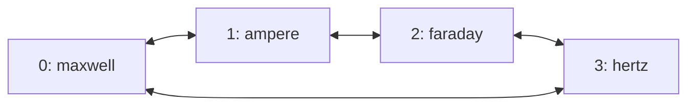

# RoCE ring transport

Flare's experimental `--roce-ring` option connects each tensor-parallel rank to
its neighbors in rank order. A native CPU proxy forwards transfers addressed to
other ranks through those neighbors. The transport supports 2 through 16 ranks;
each model recipe still determines which tensor-parallel sizes it can prepare.
GLM-5.3 Flash and Qwen3.8 Flash prepare multi-host TP2 and TP4 packages.

Ring routing applies to RoCEnante's one-shot reductions, two-shot reductions,
and variable-length gathers. The collective algorithms and arithmetic remain
in the prepared GPU programs. Routing, registered relay buffers, and RDMA
progress belong to the native transport. Serving has no Python callback,
runtime compilation, or steady-state GPU allocation.

Orbit also uses this rank order and fabric discovery for encrypted TCP checkpoint
reads, prepared exports, and package distribution before serving when
`--roce-ring` is selected. Agents stream bytes through their neighbors; this is
separate from the RDMA proxy and its captured regions. See
[checkpoint range reads](multi-host.md) and
[package transfers](orbit.md#package-transfers-through-ring-interfaces).

The ring can run over a switch or hosts cabled directly to their neighbors.
Forwarding runs on host CPUs; ConnectX hardware hairpin forwarding is not
implemented. Four-Spark native transport and GPU graph replay checks pass on a
switched fabric. The four-Spark physical ring also completed GLM-5.3 Flash
preparation, export, package distribution, and native inference as measured below.

## Rank order and routes

Ranks form the cycle `0,1,...,N-1,0`. With exactly one candidate per rank,
the cluster's node list in the controller's orbit file gives the rank order.
Longer lists can skip unsuitable nodes during placement; use an exact list
and inspect the printed placement to preserve physical neighbor order.
During preparation, each peer's `ignition join --rank` assigns the
corresponding position.

For example, a cluster listing `maxwell, ampere, faraday, hertz`:



Only neighboring queue pairs connect. A transfer to a neighbor uses a direct
RDMA write. A transfer to another rank follows the shorter direction around the
cycle; equal-length paths follow increasing rank numbers, wrapping at N.

| Transfer | Path | Forwarding |
| --- | --- | --- |
| Rank 0 to rank 1 | `0 → 1` | Direct |
| Rank 0 to rank 3 | `0 → 3` | Direct |
| Rank 0 to rank 2 | `0 → 1 → 2` | Rank 1 relays the transfer |
| Rank 1 to rank 3 | `1 → 2 → 3` | Rank 2 relays the transfer |

Two ranks have one distinct neighbor each; three or more have two. A switch
does not add direct connections between non-neighbors in ring mode.

Each serving host discovers its active RoCEv2 devices. Ranks exchange device
endpoints and plan up to two rails per neighbor. On a switched fabric, matching
device indexes carry the rails when their addressing permits it. With direct
cables, the planner pairs local and remote devices on a common IPv4 subnet.
It discovers at most four devices per host, allowing the two PCIe functions of
each cabled Spark port to participate. Every neighbor must have enough reachable
links for the selected rail count.

Flare does not configure interfaces, addresses, cables, switch forwarding, or
firewall rules. A physical ring needs both neighbor links and suitable RoCEv2
addressing already configured.

## Transfer progress and buffer ownership

Captured GPU kernels exchange data through a registered host region whose
layout and address are recorded in the package. Kernels stage payloads and
publish readiness words; the proxy posts RDMA writes and publishes the flags
that receiving kernels wait for. The proxy performs transport work, not the
model's reductions.

Ring mode also allocates about 2.01 MiB of registered host memory per rank at
startup. This fixed-capacity region contains relay mailboxes, acknowledgment
words, and outgoing descriptors for up to 16 origins and two rails. It is
separate from captured graph storage and the package's collective region.
Relay payloads occupy at most 64 KiB per packet.

A transfer from rank 0 to rank 2 through rank 1 proceeds as follows:

1. Rank 0's proxy splits each rail's payload into bounded packets. It writes a
   packet into rank 1's mailbox reserved for origin 0 and that rail, then
   publishes the packet's serial number after its payload and descriptor.
2. Rank 1's proxy observes the serial number and validates the destination,
   bounds, and progress toward the destination. For a longer path, it forwards
   the packet to the next relay's mailbox. In this example, rank 2 is already
   its neighbor, so it writes directly into rank 2's collective region.
3. The final payload write is ordered before the destination's readiness flag.
   The last relay waits for its send completion, then acknowledges the packet
   to the preceding hop. Longer paths pass acknowledgments back through each
   relay to the origin.
4. Rank 0 waits for that acknowledgment before submitting its next packet on
   the same rail. Relay buffers and outgoing descriptors remain live until
   downstream acknowledgment permits reuse.

The acknowledgment protects data still being read by a NIC. Receiving GPU
programs consume data through their collective readiness flags and sequence
protocol; a relay acknowledgment does not mean the destination GPU has finished
using the payload.

Every origin has separate mailbox credit on each rail. A stalled origin does
not hold another origin's mailbox. While waiting for credit or completions, the
proxy also progresses incoming relay work. Packets advance toward their
destination rather than circulating indefinitely.

Two-shot reductions need a further lifetime boundary. After posting its
all-gather writes, the proxy waits until its own sends have completed before
publishing `pipe_done`. The GPU kernel waits for that sequence before advancing
the epoch that permits the next operation to overwrite `pipe_send`. Receiving
every peer's output alone does not release a rank's own send buffer.

## Preparation and serving

Follow the [multi-host requirements and agent setup](multi-host.md#requirements)
first. Use the same Flare revision and locked preparation dependencies on every
host. From each checkout root:

```sh
uv sync --locked --extra prepare --extra test
cargo build --release --manifest-path flare/Cargo.toml
```

Preparation and serving use proxy ABI 9. Packages prepared with an earlier RoCE
proxy ABI require re-export; startup rejects a mismatch before replay.

### Prepare across four hosts

On `maxwell`, choose an unused output filename and an available rendezvous port:

```sh
.venv/bin/ignition export glm-5.3-flash --gpus 0 --ranks 4 \
  --rendezvous maxwell:29630 --roce-ring --cluster ring --transfer-streams 8 \
  --max-concurrency 4 \
  --output /data/flare-runtime/glm53-ring-tp4.safetensors --verbose
```

Run the corresponding command on each peer from its checkout root:

```sh
# ampere: rank 1
.venv/bin/ignition join maxwell:29630 --rank 1 --ranks 4

# faraday: rank 2
.venv/bin/ignition join maxwell:29630 --rank 2 --ranks 4

# hertz: rank 3
.venv/bin/ignition join maxwell:29630 --rank 3 --ranks 4
```

Rank zero sends the preparation option to peers. The plan records `roce_ring`,
and the package cache key includes it. `ignition serve` also accepts the option
with `--ranks` for development without package export.

The paired agent cluster must list exactly these hosts in preparation rank
order. GPU UUIDs validate that mapping before the controller signs the
checkpoint route. `--orbit-file` and `--key-file` select nondefault controller
files. Each peer fetches only its routed checkpoint ranges through 1..64 streams
(eight by default), alternating the available fabric rails. Rank 2 reads through
rank 1. Range requests retain their authenticated catalog, exact bounds, and
completion accounting. Buffering is bounded by the stream count; one reusable
4 MiB memory-backed buffer feeds the native weight loader without writing received
weights to peer NVMe. Export payloads return over the same authenticated fabric
channels; rank zero assembles and signs the package locally. Metadata and
coordination stay on the management rendezvous. Agents on every hop and the Flare
executable used by Ignition must include checkpoint transport support.

### Serve through the agents

From the controller, define the ring's exact node order in the orbit file:

```toml
[cluster.ring]
nodes = ["maxwell", "ampere", "faraday", "hertz"]
```

Then launch:

```sh
flare orbit run maxwell:/data/flare-runtime/glm53-ring-tp4.safetensors \
  --cluster ring --gpus 0 --roce-ring --host 127.0.0.1 --port 8001
```

The example binds HTTP to loopback on rank zero, so access it on Maxwell or
select a reachable bind with `--host`. It uses each node's installed agent
executable unless an explicit override is supplied. The grant carries
`--roce-ring` to every rank. If starting ranks manually, pass
it to every rank along with the usual rank and rendezvous options.
Ranks that disagree about ring mode fail during transport record exchange.

Select ring mode explicitly during serving, including for a package prepared
with the option. The serving flag chooses routing independently of the
package's graph catalog. A compatible ABI 9 package can use either transport
without changing its captured addresses or collective algorithms. Preparation
on a physical ring also needs `--roce-ring`, because non-neighbor direct routes
are unavailable during warmup and capture.

## Validation and limits

FlashInfer provides a CPU-driven validator at
`tests/experimental/b12x/comm/validate_roce_ring_native.py`. It drives the real
C proxy through the collective region without creating a CUDA context. The
validator checks every byte of mixed one-shot, two-shot, and variable-length
transfers, including empty contributions, unequal shards, and buffer reuse.

From a matching FlashInfer checkout, run one process on each host. For example,
on `maxwell`:

```sh
python3 tests/experimental/b12x/comm/validate_roce_ring_native.py \
  --rank 0 --world-size 4 --rendezvous maxwell:29783 \
  --iterations 120 --skew-rank 2
```

Run the same command on `ampere`, `faraday`, and `hertz`, changing `--rank` to
1, 2, and 3 respectively. `--skew-rank 2` delays one sender; keep it identical
on all four commands. The default HCA names and GID index match the switched
Spark lab. Other fabrics must supply their own `--hca-names` and `--gid-index`.
Add `--mesh` on every rank to validate ordinary direct routing.

On the switched Spark fabric with two rails, the shared proxy passes native
RDMA ring checks with 120 mixed operations per rank across four physical
hosts and 90 per rank across six logical ranks on three hosts. Contributions
match byte for byte with sender delays of up to 3 ms. Every ring rank connects
only its two neighbors and forwards packets; mesh checks use direct peer
connections without forwarding. Route-planning unit tests cover physical and
switched endpoint layouts through 16 ranks.

Four-rank GPU qualification of proxy ABI 9 at FlashInfer revision `c46a0b5`
reports 109 passing cases and one capacity skip per rank. The graph stress cases
exercise mesh and ring transport with changing two-shot sizes from 2 through
16 MiB, plus mixed one-shot, variable-length, and
two-shot operations. They check changed inputs and contribution counts across
18 or 20 replays, with rotating 25 ms proxy pauses and rank-dependent submission
delays. Two-rank qualification of the guarded proxy reports 110 passing cases
and one capacity skip per rank, including successful execution at the last
accepted generation and explicit failure on the following generation in both
mesh and ring modes.

Removing the GPU wait for `pipe_done` from a copied source produces a data
integrity failure in the four-rank ring stress graph when message sizes change.
The shared GPU suites also exercise stopped-proxy timeouts and invalid
variable-length counts. Permanent relay failure under arbitrary schedules
and arbitrary physical-ring model workloads remain unqualified. CPU relays,
extra RDMA hops, and per-packet acknowledgments require complete graph and serving
measurements before making performance claims. The GLM results below exercise
one full-model physical-ring workload; switched-fabric results alone do not
establish physical-ring performance.

### TCP package distribution

On 2026-10-20, four directly cabled DGX Sparks transferred the existing signed
`deepseek-v41-flash-1017-csf-ring-tp4-c4-dspark5` package using
`orbit push --roce-ring`. Each peer received and verified 118.5 GiB in three
files; rank 2's payload passed through rank 1, and rank 3 used the closing link
from rank 0. The large files sustained 489–529 MiB/s per peer. Bulk transfer
finished in about four minutes; the complete command, including stored-data
verification, took 412.59 seconds. A warm push reused all three verified peer
caches and completed in 0.19 seconds.

The [raw measurements](measurements/roce-distribution-20261020/) include command
timings, agent logs, interface addresses and speeds, and byte counters spanning
the bulk transfer. Fabric counters show rank 1 receiving two shards and forwarding
one; management traffic remained below 1.1 MB per host in that window. These
hosts report 200 Gb/s fabric ports and 1 Gb/s management links. For this setup,
the operator identifies a 100 Gb/s TCP ceiling per twin interface. Concurrent
transfers in both ring directions can reach at most 100 Gb/s each: the two
physical Spark ports share a 200 Gb/s ceiling through the same PCIe lanes.
Reported port speeds therefore do not represent independent TCP budgets.
The experiment used isolated agents on port 29910 and fresh caches; existing
agents, caches, host routes, and SSH configuration were preserved.

The measured 489–529 MiB/s is about 4.1–4.4 Gb/s per peer, well below the
100 Gb/s interface ceiling. The experiment validates TCP distribution and
package verification; it does not measure the hardware ceilings above.
In this initial implementation files alternated rails sequentially; a file was
not striped across parallel connections. This run did not include a matching
cold management-transfer baseline, throughput profiling, or a new inference run.
Socket tests cover six agents, multiple relay hops in both directions, sparse
range contents, cache reuse, signed-interface and peer-identity rejection, and
interrupted streams.

### Checkpoint sharding through the agents

The preparation path was measured separately on the same four directly cabled
Sparks with `nvidia/GLM-5.3-Flash-FP4-Local` revision
`5b865baa418c3ebd339c310df11b5e4faa2daa18`: TP4, concurrency four, 4096-token
prefill, five MTP draft tokens, context parallelism and stream overlap enabled.
Only rank zero held the complete 165.5 GiB checkpoint. The
[checkpoint measurements](measurements/roce-distribution-20261020/checkpoint/)
retain preparation logs, live sockets, CPU/storage/interface samples and an
analysis script. These are ordinary page-cache conditions, not cold-cache tests.

| Loading path | Rank 1 after weights | Rank 2 after weights | Rank 3 after weights |
| --- | ---: | ---: | ---: |
| Management rendezvous, one stream | Incomplete | Incomplete | Incomplete |
| Fabric TCP, eight streams, disk buffer | 310.5 s | 375.6 s | 326.4 s |
| Fabric TCP, eight streams, memory buffer and parallel calibration reads | 199.1 s | 204.0 s | 200.2 s |
| Fabric TCP, sixteen streams, memory buffer | 178.4 s | 177.3 s | 171.6 s |
| Fabric TCP, thirty-two streams, memory buffer | 168.9 s | 169.5 s | 164.0 s |

Times are each peer's process elapsed time at the recipe's `after weights`
marker, including admission and loading. The management run was stopped after
505–511 seconds with only 13.9–14.9 GiB received per peer; it supplies no completed
baseline time. The fabric runs loaded every rank. The disk-buffer run stopped
before graph preparation finished. The eight-stream memory-buffer run later
failed capturing GLM's `decode4` graph because an auxiliary-stream query gather
violated RoCEnante's single capture-stream requirement; it did not export or serve a model.
Ordering that gather after the main-stream join allowed all 57 serving graphs
to capture on every rank. The sixteen-stream run then exposed a separate export
descriptor-limit failure. Bounded file ownership and fabric export streams
allowed the thirty-two-stream run to publish the signed package and all four
preparation processes to exit successfully. Rank zero took 20:30.98 overall.

During the eight-stream memory-buffer loading window, source fabric TX was 155.25 GiB.
Rank 1 received 103.62 GiB and transmitted 52.02 GiB; ranks 2 and 3 received
51.77 and 51.75 GiB. Live TCP sockets used the same two rails per hop listed
below. Management RX was about 69.4 MiB per peer for checkpoint metadata and
coordination. Peer NVMe reads fell from about 49.5 GiB each to zero, and writes
from about 49.6 GiB to less than 61 MiB, by replacing the bounded disk bounce
file with a memory-backed descriptor. Native destination copies remain serial
and preserve their existing precision, stride, and lifetime contracts.

This workload does not saturate the fabric. Rank zero read about 356 GiB from
NVMe while loading its own shard and serving strided ranges to its peers; the
checkpoint ranges carry much less data than their physical read extents.
Package-copy throughput below does not describe checkpoint-loading throughput.
Focused tests cover exact GPU copies with one, four and eight streams, bounded
parallel calibration/weight reads, authenticated completion accounting,
multi-hop encrypted streams, invalid routes, replay/tampering and interrupted
connections. Increasing concurrency also changes storage/cache behavior: root
NVMe reads during the sampled loading windows were 356.2, 347.9, and 321.9 GiB
at eight, sixteen, and thirty-two streams. These runs do not isolate stream count
from every cache and storage effect.

A separate loading-only series uses `load_glm_weights.py` with identical text
and MTP weights, A16 expert loading, the real agent transport, and ordinary
page-cache conditions. It excludes tuning, capture, and export. Unlike the full
preparation runs, this script does not load into export `PackageStorage`, so
compare stream counts within this series rather than treating its times as
interchangeable with the table above. It runs eight, thirty-two, sixty-four,
then eight streams again, without dropping host caches.

| Streams per peer | Rank 0 load | Rank 1 load | Rank 2 load | Rank 3 load | Peak source-agent descriptors |
| ---: | ---: | ---: | ---: | ---: | ---: |
| 8 | 153.23 s | 209.46 s | 213.59 s | 209.52 s | 113 |
| 32 | 169.85 s | 158.98 s | 161.71 s | 159.01 s | 401 |
| 64 | 170.65 s | 154.84 s | 160.89 s | 159.55 s | 785 |
| 8, repeated | 149.80 s | 193.91 s | 197.76 s | 193.85 s | 113 |

All sixteen processes completed successfully. Each peer received exactly
53,002,660,524 payload bytes (49.36 GiB) and authenticated completion accounting
matched. Root fabric TX was 155.25–155.26 GiB per run, with about 69.4 MiB of
management RX per peer for metadata. At 64 streams, rank 1's relay agent peaked
at 401 descriptors; both source and relay stayed below the unchanged soft limit
of 1,024. The native bridge borrows its local socket through the scoped worker
join instead of cloning two additional descriptors per stream.

The repeated eight-stream load was faster than the first, so these are not
cache-controlled speedup ratios. Both eight-stream runs were slower on the
peers than thirty-two streams, while sixty-four offered little further benefit.
Root NVMe reads were 339.4, 349.9, 354.3, and 341.6 GiB across the four runs;
the first peer runs also recorded about 1.6 GiB of NVMe reads, versus near-zero
reads in subsequent runs. Loading and strided source reads
remain material costs, and increasing streams alone did not saturate the ports.

### Export payloads through the ring

The thirty-two-stream run reused the authenticated checkpoint channels for
prepared payloads in the reverse direction. Rank zero received all three peers
concurrently, verifying each file before publishing it into its cache:

| Peer | Missing payload received | Receive time | Payload throughput |
| --- | ---: | ---: | ---: |
| Rank 1 | 44.02 GiB | 93.66 s | 4.04 Gbit/s |
| Rank 2, through rank 1 | 44.02 GiB | 93.72 s | 4.04 Gbit/s |
| Rank 3 | 44.02 GiB | 95.19 s | 3.97 Gbit/s |

The retained export counter snapshots show 138.25 GiB arriving at rank zero's
fabric interfaces, including framing and network overhead, versus 9.24 MiB on
management for manifests/control. Rank 1 received 46.20 GiB and sent 92.23 GiB
on the fabric, forwarding rank 2's payload alongside its own. Sockets remained
on the signed `10.10.*` rails. One-second interface samples bracketed about
99.7 seconds of active root reception, averaging 11.91 Gbit/s and peaking at
37.31 Gbit/s; these include transport overhead. The complete export phase took
770.0 seconds; producing payloads and locally hashing/assembling the final signed
package dominated the remaining time. This is not a 100 Gbit/s transfer result.

Real-socket tests cover one, four and eight export streams, verified cache reuse,
checkpoint-to-export handoff, source replacement/mutation, invalid ranges,
digests and completion accounting, truncated or unauthenticated frames, and
1,200 files under a 128-descriptor limit. A native multi-hop test sends bulk
bytes in both directions with deliberately unreachable management addresses.

### Native serving of the distributed GLM package

The exported GLM package then passed a native four-rank launch with
`orbit run --roce-ring --transfer-streams 8 --verify-weights`. Each peer received
and verified 45.2 GiB in its fresh rank cache. The detached launch returned in
127.71 seconds; HTTP became healthy another 377.80 seconds later. Rank zero's
full-package stored-data verification took about 235 seconds, while peers
verified their rank data in about 21 seconds before waiting for rank zero.
The [native measurements](measurements/roce-distribution-20261020/native/)
retain launch logs, interface/resource samples, requests, SSE events, and metrics.

One warmup and six measured requests each consumed exactly 512 prompt tokens
and generated 256 tokens with T=1, top-p=.95, seed 42, and low reasoning effort.
The two sequential requests delivered 52.96 and 55.07 output tokens/s after
first token, with first-token latency 598 and 415 ms. Four concurrent requests
completed in 13.73 seconds (74.56 output tokens/s including prefill), with
21.29–21.88 output tokens/s per request after first token. These are absolute
measurements of this package, without a matching mesh or management baseline.

All three cold and four concurrent cached retrieval checks returned the correct
code and record number for the standard 8,000-size fixture. Observed speculative
shapes included 1×2/4/5/6, 2×2, and 4×1; no graph above 16 query rows ran in this
workload. All four ranks drained and exited with status zero. Original agents
on port 29900 remained active; this validation used isolated agents on 29910.

### TCP interface recheck

A second cold distribution on the same four hosts checked live TCP endpoints,
`ip route get ... from ...`, and the network-device entries under
`/sys/class/infiniband`. Each peer again verified 118.5 GiB; the command took
420.49 seconds including verification. The [recheck measurements](measurements/roce-distribution-20261020/recheck/)
retain socket traces, interface counters, iperf results, and CPU/storage samples.
Bulk sockets used both selected rails on each path:

| Payload hop | First rail | Second rail |
| --- | --- | --- |
| Rank 0 → rank 1 | `10.10.4.1 → 10.10.4.2` | `10.10.5.1 → 10.10.5.2` |
| Rank 1 → rank 2 | `10.10.6.1 → 10.10.6.2` | `10.10.7.1 → 10.10.7.2` |
| Rank 0 → rank 3 | `10.10.0.2 → 10.10.0.1` | `10.10.1.2 → 10.10.1.1` |

These addresses belong to the RoCE-connected Ethernet interfaces. The live
management sockets carried only small control messages. In particular, rank 1
had two receiving sockets from rank 0 and a sending socket to rank 2, confirming
that it relayed rank 2's shard while receiving its own. Management RX plus TX
stayed below 1 MB on every host during the counter window spanning distribution.

Before the repeated distribution, direct TCP tests bound both endpoints to the
same rank 0–1 fabric addresses. iperf3 3.16 used ten measured seconds after a
two-second warmup, the existing 1500-byte MTU, and no routing or socket-buffer
configuration changes:

| Fabric subnet | Streams | Zero-copy sender | Received Gb/s |
| --- | ---: | --- | ---: |
| `10.10.4.0/24` | 1 | No | 24.89 |
| `10.10.5.0/24` | 1 | No | 18.31 |
| `10.10.4.0/24` | 4 | No | 89.14 |
| `10.10.4.0/24` | 1 | Yes | 22.82 |
| `10.10.5.0/24` | 4 | Yes | 78.41 |

These memory-to-memory tests confirm capacity above the package-transfer rate;
they do not include encryption, file I/O, or package verification. Ten-second
CPU samples during distribution show substantial work in ChaCha20-Poly1305 and
kernel copies. Source storage samples show 1,495–1,666 MiB/s of aggregate
reads and I/O wait; transfer threads were not continuously CPU-saturated. The
samples establish costs to investigate, not a single proven throughput limit.
The interface selection is correct; separating storage waits from encrypted
streaming costs remains necessary before choosing an optimization.

### Parallel TCP streams

The same signed TP4 fixture was distributed again with 1, 4, and 8 streams per
file, in that order, using the parallel range writer for all three runs. Each run
used a new empty destination cache and waited for verification to finish before
the next began. Each peer received and verified 118.5 GiB in three files. The
[raw measurements](measurements/roce-distribution-20261020/multistream/) retain
per-file timings, complete command timings, fabric sockets, interface counters,
and CPU/NVMe samples.

| Streams per destination file | Large-file MiB/s per peer | Slowest peer's payload time | Full push including verification |
| ---: | ---: | ---: | ---: |
| 1 | 485–523 | 244.88 s | 396.83 s |
| 4 | 1,533–2,084 | 76.76 s | 262.74 s |
| 8 | 2,749–3,324 | 42.18 s | 179.62 s |

Payload time is the sum of the destination's three logged receive durations,
including cache writes and file sync, before signed-package verification.
Eight streams reduced that maximum by 5.8× and full staging time by 2.2× versus
one stream. A warm eight-stream push reused all verified caches in 0.18 seconds.
These are single runs per count with ordinary OS page caching; caches were not
flushed and these measurements do not establish run-to-run variance. No new
inference run was performed.

The eight-stream socket snapshot shows four connections on each rail per
destination. Rank zero had eight connections on each 0–1 rail (rank 1's shard
plus the shard relayed to rank 2), and four on each 0–3 rail. Rank 1's downstream
connections stayed on the 1–2 fabric links. Management RX plus TX remained below
0.9 MB per host in every measured run. No host routing, MTU, or SSH settings
changed.

Twenty-second source samples recorded about 1.5, 4.4, and 9.2 GiB/s of disk reads
at 1, 4, and 8 streams, with process CPU usage of 140%, 599%, and 1,121%
respectively (100% is one core). Sample windows differ and include file
transitions; they characterize resource use rather than isolate a bottleneck.
Eight streams are the default for ring package transfers; `--transfer-streams 4`
selects the smaller worker count. Eight streams reached about 23–28 Gb/s per
peer including file writes, still below the 100 Gb/s direct TCP ceiling. Package
verification remains a separate substantial cost. All temporary agents were
stopped and their test caches and copied credentials removed; installed agents
and the original verified caches were preserved.

### Scaling beyond eight streams

The stream limit was extended to 64 and the same signed fixture was tested at
16, 32, and 64 streams, followed by another eight-stream run. Each run used new
empty destination caches and finished verification before the next began.
Previous test caches stayed on disk until all four runs finished; OS caches
were not flushed. All peers received and verified the same 118.5 GiB in three
files. The [scaling measurements](measurements/roce-distribution-20261020/scaling/)
include one-second interface, process, memory, CPU, and NVMe samples for the
first 90 seconds, alongside the complete transfer logs and route snapshots.

| Streams per file | Rank 1 payload | Rank 2 payload | Rank 3 payload | Full push | Best 10-second source TX |
| ---: | ---: | ---: | ---: | ---: | ---: |
| 8 (repeat) | 37.59 s | 40.64 s | 67.56 s | 141.63 s | 90.00 Gb/s |
| 16 | 46.15 s | 37.81 s | 65.51 s | 134.41 s | 83.51 Gb/s |
| 32 | 51.07 s | 45.18 s | 61.05 s | 212.32 s | 71.20 Gb/s |
| 64 | 51.55 s | 46.15 s | 46.12 s | 219.23 s | 70.23 Gb/s |

Payload durations use the same sum of per-file receive times as above. Source
TX is the largest ten-second delta in the one-second counters, summed across
all four fabric interfaces; it is not a per-link or per-destination rate. In
the eight-stream peak window, the two 0–1 rails together carried 58.6 Gb/s and
the two 0–3 rails carried 31.4 Gb/s. Neither direction reached its TCP ceiling.
Sockets and route snapshots confirmed the fabric paths at every stream count;
management RX plus TX remained below 1 MB per node per run.

More streams did not produce a consistent throughput improvement. In the first
20 sampled seconds, aggregate source TX was 77.7, 73.5, 69.5, and 66.8 Gb/s for
8, 16, 32, and 64 streams respectively. Source NVMe reads were 8.6, 8.2, 7.7,
and 7.4 GiB/s, with about 10–11 process CPU cores and 16–21% system I/O wait.
At the eight-stream peak, reads reached 10.0 GiB/s and process CPU use was
11.5 cores. Source thread counts rose from 29 at eight streams to 197 at 64.
These samples show substantial host-side costs and a plateau before network
saturation; they do not isolate one limiting resource.

Per-peer and verification times varied considerably. The two eight-stream
runs had similar payload times on ranks 1 and 2, but rank 3 changed from 37.14
to 67.56 seconds. Their full pushes took 179.62 and 141.63 seconds respectively.
Thus these runs do not establish a globally optimal count or a stable staging
latency. Eight remains the default because the higher counts did not improve
aggregate source throughput; `--transfer-streams N` now permits 1 through 64
for measurements on other packages and rings.

The expanded tests cover concurrent sparse writes and authenticated relay
transfers through 64 streams. All 120 non-ignored CLI/unit/inspection tests
passed, and every live run completed signed-package verification. No inference
benchmark was run. Temporary agents, caches, and copied credentials were
removed after measurement; installed agents and original rank caches remain
in place.

## Protocol model and runtime checks

The [RoCEnante protocol models in FlashInfer](https://github.com/local-inference-lab/flashinfer/tree/f4ca6f08b7f697da521c212b5b02187a4d82e352/tests/experimental/b12x/comm/formal)
cover GPU staging, proxy posting, NIC payload reads, completion observation,
and relay acknowledgments as separate transitions. FlashInfer owns these models
because its GPU kernels and C proxy define the protocol. Flare vendors that
revision's sequence-limited serving proxy in `helios/native/roce_proxy.c`.
The preparation dependency in `pyproject.toml` and `uv.lock` currently pins
FlashInfer main at `969eaf9f3`, which includes the W4A16 lookup fix but lacks
the separate RoCE sequence-limit guard and protocol verification additions.
Proxy ABI 9 and the GPU collective kernels are unchanged. Restore source parity
after upstream main includes both changes; keep the vendored source identical
to the dependency after its provenance header when changing the protocol.

Flare enforces three boundaries around the protocol:

- Before replay, the native transport checks the package's proxy ABI, collective
  region layout, and routing table. Rank zero waits for every rank to connect.
- After CUDA reports a frame complete, the executor checks transport health
  before publishing its completion records. A proxy failure or GPU control
  error poisons the executor; a kernel timeout is a failed operation.
- At shutdown, the runtime drains replay streams while retaining the transport
  and package. The proxy stops and destroys queue pairs before memory
  registrations and package storage are released. An unconfirmed replay drain
  retains those resource owners until process exit.

The native conformance tests exercise the ABI, preflight rejection, and GPU
control-error interpretation without opening an RDMA device or CUDA context:

```sh
cargo test --manifest-path helios/Cargo.toml --features roce \
  --lib execution::roce::tests
```

This command requires a C compiler and libibverbs development files. Formal
checks use finite configurations and explicit progress assumptions described
with each model. They do not establish CPU/GPU/NIC cache coherence, unbounded
sequence-number behavior, fault recovery, or full-model serving correctness.
The RDMA validator and GPU replay tests exercise the implementation on hardware.
The four-origin, two-rail source-ownership check enumerates all protocol prefixes
through six transitions, including polls, with a finite TLC wrapper. Its 5,077
states satisfy source ownership. Exhaustive smaller configurations separately
check finite queue accounting, deadlock freedom, and fair completion. The
bounded wrapper does not establish larger-world progress.

The serving proxy accepts collective generations 1 through 2,147,483,647.
An exhausted sequence fails before another transfer is posted and reports
`RoCE sequence space exhausted`; restart every rank to create fresh transports.
The limit keeps zero-initialized chunk-ready words distinct from staged data
and reserves zero as the healthy error sentinel. It applies to mesh and ring
routing, independently of the number of model steps or requests. Sequence wrap
is unsupported; restarting the proxy thread alone does not reset the runtime.
The currently pinned preparation proxy does not enforce this limit.

## Failures

| Symptom | Check |
| --- | --- |
| `--roce-ring requires a multi-host package with 2..16 ranks` | Use a multi-host package with a supported rank count. The flag does not add model sharding geometries. |
| `package RoCE kernels use proxy ABI ...` | Align the preparation dependency and native executable; re-export packages using a different proxy ABI. |
| `RoCE rails have a link to rank ...` | Verify rank order, active ports, GIDs, and the IPv4 subnet shared by each neighbor pair. |
| `ranks disagree on experimental ring transport` | Pass `--roce-ring` consistently to manually started ranks and use matching binaries. |
| Proxy error or collective timeout | Stop the ranks together and inspect the originating rank's error. There is no automatic rerouting around a failed neighbor. |

The transport reports failed waits and RDMA errors through Helios's shared
failure handling. It does not switch to a different topology or publish a
failed collective as a completed model step.

## Implementation

| Component | Responsibility |
| --- | --- |
| [Fabric discovery and route planning](../helios/src/execution/roce_fabric.rs) | Finds host devices and builds symmetric neighbor routes. |
| [Native transport owner](../helios/src/execution/roce.rs) | Validates the package ABI and layout, registers its region, enables the ring, and retains transport resources. |
| [RDMA proxy](../helios/native/roce_proxy.c) | Posts direct and relayed writes, progresses mailboxes and acknowledgments, and releases two-shot send buffers. |
| [Cluster startup](../flare/src/cluster.rs) | Exchanges endpoints and connection records before native replay. |
| [Collective preparation](../ignition/preparation/collectives.py) | Passes the routing choice to b12x and retains the transport through export. |
| [CLI reference](cli-design.md#experimental-roce-ring-configuration) | Defines how preparation and native serving expose the option. |
