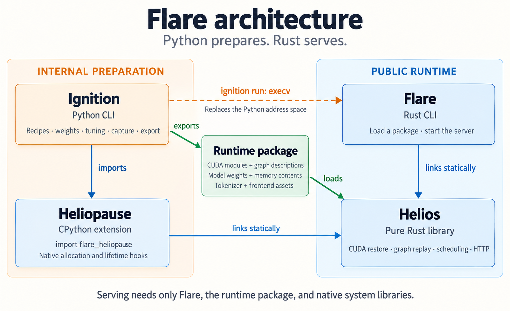

# Runtime packages: the preparation boundary and native serving

Flare serves a prepared model from a runtime package: a single `.flaretensors` file holding
everything a Rust process needs to rebuild the model's CUDA graphs and
storage without a Python interpreter. Preparation still happens in Python
with PyTorch, Transformers, and b12x. Serving requires the NVIDIA driver,
the package, the Rust `flare` executable, and its system library dependencies
(including libturbojpeg). Python and preparation tools are not required.
The [core design](core-design.md) defines the model contracts, scheduling,
and cache behavior that the served process implements; this document defines
how the prepared state leaves the Python process and how it is reconstructed.

## 1. Components

| Component | Role | Implementation |
|---|---|---|
| ignition | Internal preparation command: plans, exports, and prepares cached packages for native serving | The Python command line under `ignition/cli/` |
| heliopause | CPython extension imported by Ignition. It supplies the native preparation allocator and resource lifetime hooks | The `heliopause/` Rust crate; Python distribution `flare-heliopause`, import `flare_heliopause` |
| Helios | Rust runtime library. It rebuilds a package into a live CUDA context and serves it | The `helios/` crate, including `src/runtime_package/` and the server |
| flare | Public serving command. It links Helios to load a package and run the server | The `flare/` Rust crate; section 5 |

Preparation knowledge, recipes, planning, hub access, the kernel cache,
compilation, tuning, and capture stay on the preparation host. Ignition imports
`flare_heliopause` and exports through `ignition/preparation/runtime_package.py`
in its own Python process. `ignition run` exports a cached package when needed,
closes the prepared model, and calls `execv` to replace its entire address space
with the Rust `flare` executable. A cache hit goes directly to `execv`.
`ignition export` writes the package and exits. Graphs and Python resource owners
do not cross the executable boundary. Helios has no CPython dependency;
heliopause owns the CPython hooks and preparation allocator and uses Helios's
CUDA interfaces. Heliopause has no executable or embedded interpreter. `flare` and Helios are
the public deployment surface. Ignition and heliopause are internal preparation
tools. Dependency direction is `flare → Helios` and `heliopause → Helios`;
Helios has no dependency on either preparation tool.

## 2. The preparation boundary

Ignition records four things while preparing a model, and refuses to
write a package when any of them is incomplete.

**Storage.** PyTorch's persistent device allocations come from one address range
reserved before any other allocation: 1 TiB at `0x2000_0000_0000`, backed on
demand with `cuMemCreate` and `cuMemMap` at allocation granularity. PyTorch
allocates through a `MemPool` whose pluggable allocator is the Rust arena in
`heliopause/src/allocator.rs`, so weights, state, pages, and the
graph pool all live inside the range. Ordinary preparation and capture use
separate PyTorch pools backed by that arena. Mapped host memory, including the PLE
table, is placed by `mmap` at fixed addresses from `0x1000_0000_0000` and
registered with the driver; under unified addressing the device pointer
equals the host pointer, which the exporter checks. A CUPTI subscriber logs
driver allocations and removes records when their context is destroyed.
Persistent device allocations outside the arena are grouped into complete
VMM pages and placed within additional GiB-aligned reservations. Only their
live byte spans are considered for payload storage; page gaps are zero. Before
copying, the exporter checks that each external allocation belongs to the
serving context.

The model exporter retains allocations reachable from graph arguments, copy
and memset endpoints, module globals, native execution buffers, and declared
peer storage. It follows pointer-bearing allocation contents while writing
tensor payloads. Checkpoint transfers record numeric tensor spans with weak
storage ownership; expired or resized storage cannot reuse those declarations.
Live floating-point tensor views supply additional numeric spans, excluding
integer aliases and holes in strided layouts. Native input/output buffers are
numeric by their execution contract. These spans are leaves in the traversal:
their storage is retained when referenced, but their values are not interpreted
as addresses.

Address candidates must also fall outside blocks that PyTorch marks inactive
in the preparation allocator. Those blocks have no live allocation, so stale
values in opaque arguments cannot keep their backing segments resident. This
filter excludes the private graph pool: its intermediates remain live through
captured replay even when their Python tensors have been released. Explicit
resource bindings retain their allocations independently of candidate scanning.

Compiler-declared scalar arguments are also leaves. Triton signatures are
checked against the driver's parameter sizes; kernels with integer-to-pointer
conversions, inline assembly, or opaque calls retain conservative argument
scanning. Untyped structs, tensor maps, globals, and integer/byte storage without
a numeric role are scanned for address candidates. This can retain false
positives and retains complete backing segments, including unused bytes within
a reachable segment. The preparation metadata does not enter the serving index.
Omitted allocations keep their virtual ranges reserved and physically unmapped,
so an unexpected access faults instead of reaching another allocation.

Before export, model recipes declare disposable KV and scratch storage,
including target and MTP page pools, operator workspaces, decoder and vision
intermediates, and sampling and verification temporaries. The graph memory
pool holds only graph-local intermediates and is also cleared, as are inactive
blocks in the preparation allocator. Weight tensors, MTP weights, rotary
tables, pointer tables, and required initialized metadata retain their contents.

A model file starts with eight bytes `FLAREPKG`, a little-endian u64 index
length, and a serialized `ModelIndex` from `helios/proto/runtime_package.proto`.
The payload begins at the next 4 KiB boundary. Every resource span stores its
byte offset relative to that payload base and its byte length. The index is
limited to 16 MiB and contains ordered rank bundles, peer-memory ownership,
serving configuration, frontend asset spans, allocation descriptions, kernel
metadata, and graph declarations. TP1, TP2, and TP4 require distinct exports.

Graph bodies, cubins, module globals, packed tensor data, tokenizer data, and
other frontend assets live in separate indexed payload spans inside the same
file. A graph body contains its declared number of nodes followed by its
edges. Each record is a little-endian u32 length followed by one Protobuf
`Node` or `Edge`, with a 1 MiB record limit. Kernel arguments, node attributes,
and edge data are Protobuf byte strings. Graph bodies are independent; the
loader need not read an unselected graph to locate or select another graph.
Rust bindings are generated by `prost-build`; Ignition uses checked-in Python
bindings generated by `protoc` from the same schema.

Allocation extents are separate from stored payloads. Each allocation has
ordered, disjoint `data_spans` containing destination byte offsets and lengths.
Its payload concatenates those spans without padding. Declared disposable
ranges are excluded before device reads; remaining ranges are checked for
zero-filled 64 KiB blocks, which are also omitted. An entirely zero allocation
has an empty span list and no payload. Helios zeroes omitted regions and
copies only the stored spans to their declared offsets. Runtime-sized row and
KV allocations carry no tensor payload. The loader accepts the indexed file
format; incompatible packages must be exported again with Ignition.

**Kernels.** The same subscriber copies the image of every module and library
the driver loads, from the driver-API load calls and from the resource
callback that also covers modules loaded internally by CUDA libraries. Each
kernel node's function maps to its image through `cuFuncGetModule`. Resource
callbacks during lazy loading are associated with the driver call that
materializes the module, including launches using context-independent
`CUkernel` handles. A unique symbol-name match is a fallback. The exporter records
each function's parameter layout from `cuFuncGetParamInfo` and its dynamic
shared-memory, carveout, and cluster attributes. ELF symbol enumeration and
`cuModuleGetGlobal` capture initialized module globals and constants; native
loading restores their contents after loading each cubin.
Source-bearing debug sections and embedded PTX are erased without changing
CUDA section or symbol indices. Assertion filename globals are replaced with
`kernel`; assertion conditions and messages remain intact. Kernel symbols are
retained for lookup, so packages do not conceal the compiler that emitted them.

**Graphs.** Capture keeps the graph templates alive, and the walker records
each template node by node: kernel nodes with grid, block, shared memory,
every nonzero launch attribute, and the parameter bytes copied verbatim;
memset and contiguous device-to-device copy nodes with their driver
parameters; empty nodes; and every edge with its edge data. Nodes are ordered
by the driver's local id. Host nodes, child graphs, event nodes, conditional
nodes, kernels launched through the `extra` parameter path, and
device-updatable nodes fail the export.

**Contract.** The package carries the Helios execution manifest with buffer
addresses rewritten as allocation references, the server configuration, the
frontend assets, the device architecture, and the context flags, cache
configuration, and limits. Parameter bytes are stored exactly as captured.
Pointer and tensor-map fields may additionally be declared as relocations,
which lets a loader place storage elsewhere and rewrite the fields, tensor
maps through `cuTensorMapReplaceAddress`; the model export does not declare
them and relies on identical addresses instead.

## 3. Address rules

Parameter bytes are replayed verbatim, so a rebuilt process must reproduce
every recorded address. Three driver behaviors, measured on driver 610.57.04
with the `cr-probe` experiments under `~/projects/flare-research`, fix how
that is done.

- The driver satisfies a `cuMemAddressReserve` request from its current
  64 MiB block whenever the request fits, ignoring the requested address, and
  maps a fresh block at the requested address only when the request does not
  fit. Four 16 MiB fixed requests in a fresh process are all moved and the
  fifth is honored; a first request of 64 MiB is moved and a first request of
  128 MiB, 1 GiB, 64 GiB, or 1 TiB is honored anywhere from 8 TiB to 127 TiB.
  A package therefore uses large enclosing reservations and maps allocations
  at their recorded offsets inside them; it never relies on small fixed
  reservations. The controlled arena uses 1 TiB and external spans use
  GiB-aligned enclosing ranges.
- Host memory mapped with `MAP_FIXED_NOREPLACE` and registered with the driver
  receives the same device address in every process.
- Tensor-map parameters embed a global address and are 128 opaque bytes;
  module constant and global symbols hold whatever preparation wrote. With
  identical addresses both replay unchanged.

Conditions that break address reproduction fail loudly: the loader compares
the reserved address with the recorded one and the registered host pointer
with the recorded device pointer before it loads any contents.

## 4. Rebuild and serving

`NativeResources::load` in `helios/src/runtime_package/mod.rs` rebuilds a
package in this order: create a context with the recorded flags, limits, and
cache configuration; reserve the recorded range and compare addresses; back
each device allocation at its recorded address and map each host region;
upload contents or zero-fill; apply storage relocations; load modules and
resolve functions, checking each kernel's parameter layout against the
package; set function attributes; add nodes, attributes, and edges; and
instantiate each graph with its recorded flags. The execution manifest is
then rebased onto the live addresses and validated, and the server starts
from this reconstructed contract. `flare run PACKAGE` in
`flare/src/main.rs` supports the Qwen and GLM contracts.

Before any CUDA initialization or worker threads, Flare restricts
`CUDA_VISIBLE_DEVICES` to `--gpus`, resolving indices within an inherited mask.
Rank order follows the selected list; Helios receives contiguous device ordinals
starting at zero, while loading progress retains the CLI's GPU labels. Flare
sets `CUDA_FORCE_PRELOAD_LIBRARIES=0` and `CUDA_DISABLE_JIT=1`. The loader requires
compiled cubins; missing native GPU code fails instead of compiling PTX.

`LoadOptions` selects runtime concurrency, MTP draft-token count, and adaptive
or fixed verification before any CUDA context is initialized. Ignition captures
every power-of-two batch capacity up to the concurrency maximum and every
verification width up to the draft-token maximum plus one. Execution metadata
identifies graph kind, sampling mode, batch capacity, token capacity, draft
source, draft count, and verification count; the
loader uses these fields rather than graph names to select variants. It checks
required batch coverage and identical selected catalogs across TP ranks.
Draft count and verification count are independent declaration fields.
Verification count includes the pending input token. For a given selected
batch and verification width, the loader chooses one permitted draft count;
it never loads duplicate MTP alternatives for that shape. The index lists
each graph's function dependencies, so kernel selection also precedes graph
body reads. Selection does not infer semantics from graph names.

`flare run` accepts `--max-concurrency N`, `--mtp-draft-tokens N`, and either
`--mtp-adaptive-verification` or `--no-mtp-adaptive-verification`. Unspecified
settings retain package defaults. Reductions must be supported by captured
graphs; a concurrency limit of three still requires the batch-four bucket.
Zero drafts selects width-one verification, retaining MTP state and weights.
Missing variants and increases beyond package capacities fail before allocation.

Unselected graph templates and executables are never reconstructed. Functions
used only by omitted graphs are dropped, as are unused modules without globals.
Modules with globals retain their persistent contents. Weights, MTP weights,
and fixed scratch remain intact because opaque kernel parameters and persistent
device storage can embed their addresses. `SchedulerLimits.max_active` controls
admission, while `request_slots` preserves the captured physical buffer strides,
and completion-frame extent. The scheduler selects from the
loaded graph catalog instead of deriving a capture budget.

Continuation storage and KV pools use runtime-sized allocation records. Each
record declares its capacity group, bytes per unit, fixed virtual base, alignment,
and maximum units. The package reserves the full virtual extent and stores no
tensor payload or prescribed physical size for these records. Per-rank 1 TiB
reservations place fixed resources in the lower half and runtime-sized regions
in the upper half. Maximum extents are chosen during preparation and validated
for overflow and overlap before loading.

Helios maps physical prefixes after loading fixed storage, kernels, and graph
executables and uploading every selected graph. It leaves 64 MiB for driver
bookkeeping, execution streams, and events, plus the package's `reserve_bytes`
when configured. Ignition exports `memory.reserve` as this optional serving
reserve, which defaults to zero; preparation's warm-up and capture headroom does
not reduce the serving budget. All ranks use the same
row and page counts, limited by the rank with the smallest remaining budget.
Rows comprise one null row, `concurrency * verification_width` execution rows,
three admission checkpoint destinations per active request, and a prefix cache.
The prefix cache targets eight rows per request, with an eight-row floor and a
quarter-share memory limit. KV pages receive the remaining budget, within their
virtual maximum. The planner accounts for each allocation's mapping alignment
and requires at least 8,192 cached tokens per active request.

The loader writes the chosen physical row and page counts into `memory_capacity`.
Maintenance kernels consume those device scalars; kernels preserve fixed row
strides and base addresses. Request-to-row bindings separate transport slots
from execution rows. Execution and prefix-cache partitions are fixed at load
time, with no row leasing or steady-state remapping. Model recipes declare row
contents and KV geometry; the memory planner does not depend on recurrent or
attention architecture.

The loading display separates allocation capacity from payload bytes.
`Allocate model memory` reports GPU and host capacity. `Load weights` counts
only bytes present in allocation payload spans, including initialized model
metadata, and excludes disposable storage and elided zero blocks.

The loader reads only the bounded index before selection. It decodes selected
graph bodies one record at a time, retains dependency bookkeeping for one
graph, and destroys each CUDA graph template after instantiation and upload.
Cubins are mapped from their file spans while loading; no anonymous copy of
the full kernel catalog is required. Frontend assets are read from their own
file spans. The index and loader metadata are released after startup.

Payload loading uses two file-reader threads and four pinned staging buffers
per rank. Each buffer holds `4 MiB / rank_count`, keeping total staging capacity
at 16 MiB. Each rank uploads device chunks asynchronously on its own CUDA stream;
completion events guard buffer reuse. Host-resident
payloads are read directly into their final mapped allocations. Readers join
and uploads drain before relocations, module loading, or graph execution.

A rebuilt process holds no Python mapping, which its tests assert by reading
`/proc/self/maps`. On a 16 MiB working set the rebuild costs 0.5 s, of which
0.45 s is context creation and reservation; at model scale the cost is the
contents transfer, bounded by storage read and PCIe upload.

## 5. The flare command

flare resolves its argument to a package, calls the linked Helios library,
supplies the bind address and API key, handles signals, and reports readiness.
Flare owns the terminal banner. Helios supplies loading stages with measured
progress, cycling bars for indeterminate work, results, and elapsed time.
Helios validates the package before reconstruction:
the package's GPU architecture matches the selected device, the recorded
address range is free, free device memory covers the recorded footprint, and
the package's execution contract version is one the Helios build
understands. It does not pin a driver version or a Helios build, because sm_120
SASS loads on any driver that supports the architecture and a package stays
valid across Helios builds that keep the contract.

flare has no recipe catalog, no planner, no hub access, and no kernel cache.
Those belong to ignition.

## 6. Tensor-parallel ranks as threads

Qwen TP2 uses one Rust process with one CUDA execution thread per rank. Rank
zero's thread also runs the scheduler. In-process channels carry prepared
steps to peer threads; every rank validates the same fence and uploads before
commit. Completion records must agree on request epochs, token consumption,
and status. A 120-second deadline bounds a stranded collective. Shutdown
confirms drain on every rank before releasing any shared storage.

Preparation uses one Python process per rank. Each process reserves every
rank's 1 TiB arena; rank r owns device base `0x2000_0000_0000 + r * 2^40`
and host base `0x1000_0000_0000 + r * 2^40`. b12x collective allocations
use the native package allocator. POSIX descriptor passing shares VMM physical
allocations, and importers map each allocation at its owner's recorded address.
Collective signals and generation-tagged payloads are reset after all ranks
drain. Imported mappings are recorded as peer dependencies and stored only in
the owning rank's bundle.

Helios checks that rank allocations do not overlap, creates every device
context, loads rank storage, and grants the declared peer access through
`cuMemSetAccess` before loading modules and instantiating execution state.
Address reservations are established before allocation. Allocation, payload
loading, kernel loading, and execution preparation each run concurrently across
ranks, joining all rank threads between stages. Loading retains a process-wide
16 MiB pinned staging bound and displays aggregate progress for each stage.
Serving uses ordinary shared pointers; no IPC import,
Python process, or socket protocol is involved. TP4 follows the same resource
layout but requires separate model validation.

## 7. Process images

A CRIU image taken with the driver's process checkpoint support restores a
loaded Helios process bit-exactly: every state class a prepared model holds
was verified, including tensor maps, module symbols, pinned and registered
host memory, two devices with peer access in one process, and legacy IPC
across a process tree launched inside a cuda-checkpoint job. Images are not
the production path. Restore moves the same bytes a package load moves, once
into anonymous host pages and once to the device, so it is bandwidth-bound in
the same way; measured at a 70 GB footprint, restore from an NVMe image took
29 s and from RAM about 13 s. An image is valid only on the driver build that
produced it, bakes in the Helios binary, needs root and CRIU on the host,
holds the whole device footprint in host memory during dump and restore, and
is corrupted if any thread touches GPU-side driver state during the
checkpoint window, including a thread polling `cuEventQuery`.

Images remain a validation tool: image a loaded Helios once, and after a
kernel, driver, or loader change compare a fresh load's replay against the
restored image. The probes, orchestration, and measurements live under
`~/projects/flare-research`.

## 8. Open items

- Full-model relocation requires complete pointer and tensor-map bindings in
  parameters, persistent storage, and module globals. The loader accepts typed
  relocations, but the model exporter preserves addresses for opaque resources.
- GPUDirect Storage is not integrated; device payloads pass through the bounded
  pinned staging buffers.
- The sm_120 TMA tile path links against driver-provided code and reserves
  about 3.6 GiB of device memory per context when loaded; the memory plan
  should account for it once b12x kernels that use the path are identified.
