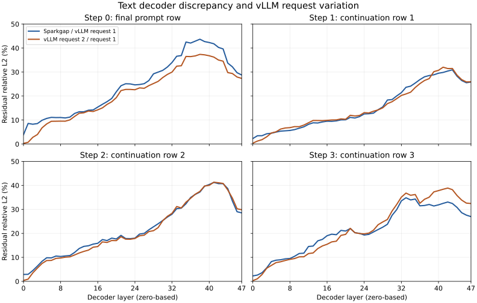

# Text decoder layer comparison

Flare and the pinned vLLM serving path first differ at layer 0's
hyperconnection normalization. Their input residuals are identical; normalized
outputs differ by 0.0223–0.0645% relative L2 across four token contexts. The two
implementations use different precision for the normalization weights:
Flare retains the checkpoint's FP32 values; vLLM loads BF16 values.

The vLLM reference also varies between requests. Two identical cold requests in
one engine first differ at layer 0's MoE output, despite identical recorded
attention results, hyperconnection projections and MoE inputs. The resulting
0.29–0.39% difference in layer-0 residuals grows to 18.95–23.96% in full-vocabulary
logits. The same reference request differs from Flare by 19.35–20.26% in logits.
A final-logit difference of that magnitude does not isolate an implementation
defect in Flare.

## Inputs and observation boundaries

The checkpoint is
`local-inference-lab/Qwen3.8-Flash-Next-NVFP4-MXFP8-CSF-QAD`, revision
`dc5b8ab2fa14bc4fecd6886273b7ebc6095662e2`. vLLM uses revision
`64fc1eec593397cbd765cc082e9ec90fbeb5ea66` with FlashInfer
`98fb87a461183f98d6a7049ca947fb136cc6fb59`, TP1, BF16 KV and convolution state,
FP32 GDN recurrent state, and no speculative decoding. Sources and all 21
checkpoint shards match the [serving oracle](text-serving-oracle.md).

Prompt IDs are `[760, 6511, 314, 9338, 369]`; consumed teacher IDs are
`[11751, 13, 561]`. Context lengths are 5, 6, 7 and 8. Both implementations
retain every post-MLP residual boundary across all 48 layers, plus intermediate
outputs from layer 0. vLLM's deferred residual additions are observed when they
materialize, before PLE or the following attention block. These are copies of
model-produced tensors, without recomputing residual arithmetic.

Flare executes capacity-512 prefill and single-row decode graphs. vLLM
executes eight padded rows for the five-token prefill and one row for each
decode step. Only the five active prefill rows and the single decode row are
compared. The second vLLM request follows successful prefix-cache invalidation
after completion of the first request.

## Layer progression

The reference below is the first request in
`vllm-inprocess-repeat/`. Both curves use that same reference and its norm as
the denominator. Values use CPU FP32 arithmetic. The final active row at each
layer is shown; full artifacts also retain aggregate and individual prefill-row
measurements.

The initial cross-implementation discrepancy is larger than the repeat
variation. Through later layers, both comparisons show similar growth. Neither
comparison identifies a single later layer at which the complete logit gap
suddenly appears.

## Layer-0 measurements

Stage errors include every active row: five for prefill and one for decode.

| Boundary | Flare / vLLM relative L2, range across four contexts | vLLM repeat / vLLM |
|---|---:|---:|
| Embedding and input residual | 0 | 0 |
| Attention HC normalization | 0.0223–0.0645% | 0 |
| Attention block input | 0.0296–0.0559% | 0 |
| GDN gated output | 0.485–0.571% | 0 |
| Attention output projection | 0.992–1.794% | 0 |
| MoE block input | 1.302–3.089% | 0 |
| MoE output | 3.032–3.619% | 0.382–0.524% |
| Post-MLP residual | 2.27–2.88% | 0.287–0.394% |

The FP32-versus-BF16 normalization-weight policy fully explains the first
unequal operation in the matched-input GPU measurement below. HC projection
implementations, GDN configurations and MoE reduction policies also differ;
downstream errors cannot be assigned to one of those choices without
matched-operand execution.

The selected vLLM dynamic MoE path uses BF16 atomic output additions with
arrival-dependent order. Ten routed experts and five intermediate slices yield
approximately 50 contributions per output element. The deterministic b12x path
changes the grouping and rounding of those contributions.

## Matched-input normalization

`scripts/qualify_hc_normalization.py` executes the public b12x normalization
operations using the recorded plans, exact checkpoint weight and saved residual
inputs. All eight original-output reproductions are byte-exact: four contexts
for each implementation. The probe preserves execution capacities of 512/1
rows for Flare and 8/1 for vLLM. Unobserved padding rows are zero-filled;
normalization has no cross-row reduction.

Three weight configurations are evaluated on each geometry: original FP32
gain, FP32 gain formed from BF16-rounded checkpoint weights, and vLLM's BF16
zero-centered weight. Rounding the weight explains all 502, 96, 100 and 97
different output elements in the four contexts. With equivalent gains, the
two public normalization paths produce identical output bytes in every case.
The first cross-implementation difference is therefore weight precision,
without a residual normalization-kernel discrepancy on these inputs.

All 73 checks pass across 32 captured graphs and 160 replays, with zero replay
allocations. The installed and pinned hyperconnection source files are
byte-identical. Inputs and sources remain unchanged; the process exits zero
and GPU memory returns to 2 MiB. The report and raw tensors are under
`hc-normalization-json/` in the artifact root. An initial run's report
serialization failed on a declared infinite plan sentinel; its log, source and
raw tensors remain under `hc-normalization/`. The successful run changes only
that metadata encoding and reproduces the identical tensor artifact hash.

## Routed-expert repeatability

A separate pair of cold requests records the actual router outputs and the
shared/routed expert tensors after the existing stream join. Router logits,
all 80 ordered expert IDs, all 80 route weights and shared-expert outputs are
identical. The first differing substage is routed-expert output at every context.

| Context step | Routed-expert relative L2 | Full-logit relative L2 |
|---:|---:|---:|
| 0 | 0.5967% | 18.3521% |
| 1 | 0.8812% | 16.6298% |
| 2 | 0.8467% | 19.7687% |
| 3 | 0.8421% | 20.2994% |

The source implementation and matched operands locate this variation in routed
execution with BF16 atomic accumulation. Both requests pass observation
coverage and fail original-baseline logit equality. Complete tensors are under
`vllm-moe-inprocess-repeat/`; `moe-layer-analysis/` contains the measured
substage errors, route counts, source identities and all 48 layer comparisons.

Flare and vLLM choose the same expert sets on all eight recorded rows.
Their ordering differs on two rows. Flare rounds route weights through BF16;
vLLM retains FP32 values, and all 80 recorded weights contain precision lost
by BF16 conversion. This is an additional arithmetic difference. The
cross-implementation expert inputs already differ, so those expert outputs
are not a matched-input kernel comparison.

## Validation and retained evidence

Both repeated vLLM requests pass all stage-coverage, token-position and
finiteness checks. Both fail bitwise logit equality against the original
uninstrumented oracle, and the qualification exits nonzero. That failure is
retained. An independent uninstrumented repeat also varies by 16.68–20.94% in
logits. The repeated instrumented requests use identical loaded weights,
selected plans, module bindings and configuration. GPU memory returns to 2 MiB
on shutdown; source and checkpoint identities remain unchanged.

The Flare trace completes with zero CUDA allocations during native replay.
Its HC residual combination uses public `b12x.norm.hyperconnection.run_combine`.
The corresponding trace, selected plans and source snapshots are retained under
`flare-b12x-combine/` in the artifact root.

The [compact receipt](text-layer-comparison.json) identifies the tensors,
comparison reports and complete layer tables. Full artifacts are under
`/data/sparkgap-artifacts/text-layer-trace/`. The `layer-analysis/` directory
contains full JSON metrics, CSVs with all 48 layers and all four contexts, and
SHA-256 manifests. The layer comparator validates token contexts, complete
vocabulary, tensor shape, dtype and finiteness before comparing. It applies no
numerical tolerance. Task-level generation agreement remains unqualified.
The combined CPU observer, reconstruction and comparator suite passes 105
tests. `artifact-index.json` in the artifact root records every retained file's
size and SHA-256.

## All 48 layers

Each value is a percentage of the reference residual L2 norm at the final
active row. `SG N` compares Flare with vLLM at context step N; `V repeat N`
compares the second vLLM request with the first at that same step. Layer indices
are zero-based.

| Layer | SG 0 | SG 1 | SG 2 | SG 3 | V repeat 0 | V repeat 1 | V repeat 2 | V repeat 3 |
|---:|---:|---:|---:|---:|---:|---:|---:|---:|
| 0 | 3.9022 | 2.2813 | 2.8793 | 2.2660 | 0.2819 | 0.3569 | 0.3944 | 0.2868 |
| 1 | 8.5903 | 3.4564 | 2.9354 | 2.6280 | 0.7353 | 1.2361 | 0.9157 | 1.0791 |
| 2 | 8.2606 | 3.4808 | 4.4913 | 3.6055 | 2.7999 | 1.8339 | 3.5179 | 2.8692 |
| 3 | 8.5282 | 4.2764 | 6.3761 | 5.6318 | 3.9727 | 3.0137 | 5.5514 | 5.4711 |
| 4 | 9.9149 | 4.4995 | 8.3662 | 8.2377 | 6.7656 | 4.5971 | 7.4617 | 6.6454 |
| 5 | 10.6801 | 4.9692 | 9.8387 | 8.8152 | 8.3933 | 5.0918 | 8.6764 | 7.8059 |
| 6 | 11.1123 | 5.3817 | 9.7795 | 8.9978 | 9.4815 | 6.2457 | 8.7268 | 8.1701 |
| 7 | 11.0281 | 5.5164 | 10.5496 | 9.3774 | 9.5096 | 6.6955 | 9.5708 | 8.7047 |
| 8 | 11.0559 | 5.6593 | 10.3683 | 9.5209 | 9.5456 | 6.8331 | 9.7324 | 9.1697 |
| 9 | 10.8726 | 6.0109 | 10.5975 | 10.4469 | 9.5219 | 7.2588 | 10.0758 | 9.5042 |
| 10 | 11.2276 | 6.5945 | 10.7639 | 11.6073 | 10.0723 | 7.2330 | 10.2188 | 10.2233 |
| 11 | 12.7431 | 7.1702 | 12.0356 | 11.7425 | 11.4969 | 7.8976 | 10.9991 | 10.2457 |
| 12 | 13.4549 | 8.2144 | 13.6965 | 14.5373 | 12.8262 | 8.8654 | 11.8246 | 11.5807 |
| 13 | 13.4480 | 8.8527 | 14.5760 | 14.7120 | 13.0234 | 9.8280 | 12.4857 | 11.8425 |
| 14 | 14.0989 | 8.7762 | 14.8384 | 16.8805 | 13.7563 | 9.8072 | 13.0233 | 13.6632 |
| 15 | 14.2109 | 9.2072 | 15.5209 | 17.5007 | 13.5568 | 9.7652 | 14.2386 | 14.7676 |
| 16 | 15.4076 | 9.5124 | 15.8658 | 19.0162 | 14.2513 | 9.8785 | 14.5030 | 15.4529 |
| 17 | 16.5637 | 9.4733 | 17.4179 | 19.6595 | 15.0700 | 10.0401 | 16.4486 | 16.4456 |
| 18 | 17.6639 | 9.6523 | 17.0002 | 19.4349 | 16.5206 | 10.0706 | 16.2100 | 16.7404 |
| 19 | 18.9857 | 10.0718 | 18.0148 | 21.2446 | 17.6048 | 10.4751 | 17.0152 | 19.1669 |
| 20 | 21.8000 | 10.1016 | 17.6689 | 20.9670 | 19.3573 | 10.3233 | 16.9772 | 19.5771 |
| 21 | 24.2986 | 11.1110 | 19.1732 | 22.0098 | 22.2782 | 11.9817 | 18.6064 | 22.0947 |
| 22 | 25.1280 | 10.8447 | 17.8504 | 20.2819 | 22.7574 | 11.6915 | 17.5767 | 20.2678 |
| 23 | 25.0581 | 11.4382 | 17.8021 | 19.9980 | 22.7602 | 11.9141 | 17.5390 | 19.9251 |
| 24 | 24.6613 | 12.5427 | 17.9960 | 19.3086 | 22.6306 | 13.0902 | 17.8667 | 19.8081 |
| 25 | 24.8028 | 12.6265 | 19.7053 | 19.5835 | 23.3959 | 12.9496 | 18.9743 | 20.1149 |
| 26 | 25.1528 | 12.8767 | 19.9990 | 20.5788 | 23.2249 | 13.6814 | 19.2503 | 21.3359 |
| 27 | 26.4508 | 14.3130 | 21.4759 | 21.5980 | 24.3441 | 14.2231 | 20.7601 | 23.6207 |
| 28 | 29.2490 | 15.4710 | 22.7408 | 22.5849 | 25.2262 | 15.0918 | 21.1124 | 24.7581 |
| 29 | 29.9762 | 18.3464 | 24.0027 | 23.7951 | 26.1108 | 16.8378 | 22.3963 | 25.8045 |
| 30 | 30.7156 | 18.5340 | 25.3658 | 27.5096 | 27.7107 | 17.6399 | 25.2782 | 29.2946 |
| 31 | 32.1019 | 20.0472 | 26.8054 | 29.8920 | 29.0243 | 18.9132 | 27.1106 | 32.0313 |
| 32 | 34.0048 | 21.4045 | 28.0027 | 33.5314 | 29.9936 | 20.2582 | 28.3648 | 35.0871 |
| 33 | 36.5862 | 23.6570 | 30.2890 | 34.8340 | 32.4539 | 20.8770 | 31.1791 | 36.7904 |
| 34 | 36.8716 | 24.1287 | 30.5108 | 33.9350 | 32.6368 | 21.6116 | 30.6024 | 35.8717 |
| 35 | 42.5148 | 25.4364 | 32.3382 | 34.3094 | 36.5041 | 23.5811 | 33.0083 | 36.1931 |
| 36 | 42.0853 | 26.8605 | 34.9470 | 31.4805 | 36.4434 | 25.1848 | 34.6191 | 32.5550 |
| 37 | 42.8844 | 28.0303 | 36.2402 | 31.6263 | 36.7289 | 26.4921 | 36.3245 | 34.2221 |
| 38 | 43.6902 | 28.5460 | 37.2125 | 32.0468 | 37.3706 | 27.2710 | 37.4865 | 35.0791 |
| 39 | 42.7098 | 28.8557 | 39.6411 | 31.4113 | 37.1766 | 30.1718 | 39.7395 | 37.2859 |
| 40 | 42.3126 | 29.5084 | 40.3517 | 31.8816 | 36.7953 | 30.7255 | 40.0107 | 37.8146 |
| 41 | 41.7931 | 29.8453 | 41.2392 | 32.5092 | 36.2406 | 32.0305 | 41.3170 | 38.3818 |
| 42 | 40.2812 | 30.4302 | 40.7266 | 33.0627 | 35.0178 | 31.4561 | 41.0968 | 38.8794 |
| 43 | 39.6306 | 30.9244 | 40.7085 | 32.4441 | 34.5317 | 31.4879 | 40.7975 | 38.2097 |
| 44 | 33.7324 | 28.2562 | 38.6677 | 30.8092 | 29.7796 | 28.7033 | 38.0865 | 35.7637 |
| 45 | 32.1775 | 26.4638 | 33.4703 | 28.5994 | 29.3861 | 26.8475 | 34.6918 | 33.8583 |
| 46 | 29.7315 | 25.5433 | 29.0245 | 27.6034 | 27.9301 | 25.8928 | 30.2585 | 32.6201 |
| 47 | 28.7812 | 25.8385 | 28.5503 | 26.9826 | 27.3653 | 25.9449 | 29.8532 | 32.4365 |
